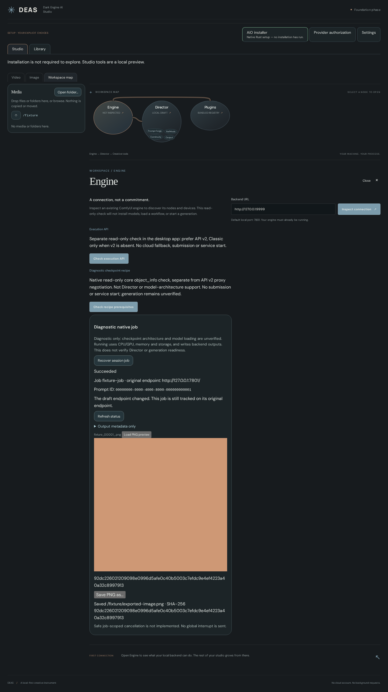
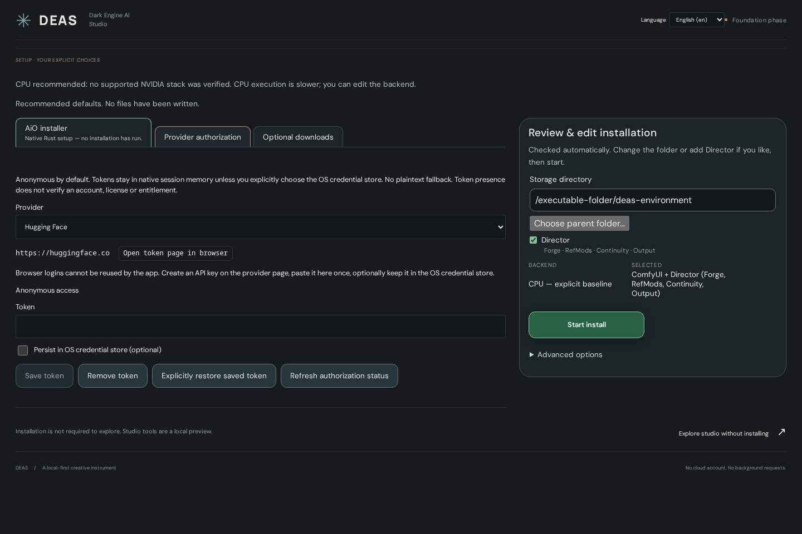

# DEAS — Dark Engine AI Studio

DEAS is a Rust/Tauri desktop studio for ComfyUI and DaSiWa tools. Studio, Library and Comfy share a tab band; installer, authorization, Settings & Backend and Logs are header actions. The studio preview shows a workspace map of connected feature blobs; selecting a blob opens its controls within the page.

Generate seed controls offer Random/Fixed, New, ±1, Use last and the last ten submitted seeds with restore/copy. Seed settings and history survive restarts; seeds remain exact within the existing 0–9007199254740991 contract.

Media has a separate left-hand folder navigator. Expand arrows reveal subfolders on demand; clicking a folder name changes the displayed files. The media tile panel contains no folders. Existing depth, search, sorting, Input/Output shortcuts and drag-and-drop remain available.

## Getting started — Windows and Linux

**DEAS is early-alpha software.** Linux CPU/NVIDIA installation has been tested; Windows builds exist, but running the app and its installer on Windows has not yet been verified. AMD/Intel GPU installation and video generation are not ready. Use a separate folder, not an existing ComfyUI installation.

**Start here:** [Windows](#windows-step-by-step) · [Linux](#linux-step-by-step) · [First setup inside DEAS](#first-setup-inside-deas) · [Help](#if-something-goes-wrong)

### Before you start

- Use a **64-bit Intel/AMD Windows or Linux computer**. These instructions do not cover ARM devices.
- Have an internet connection and a writable folder with room for the app, its downloaded backend and your models. AI models can take several gigabytes each; there is no single storage requirement for every model.
- For NVIDIA acceleration, install a working NVIDIA driver first. DEAS checks compatibility; it does not install your graphics driver. CPU mode is available but much slower.
- You do **not** need to install Python, PyTorch, CUDA Toolkit or ComfyUI manually for a new DEAS-managed environment. DEAS downloads its managed Python and backend after you approve setup. Git is still required.

### Download or build?

Check the official [Releases page](https://github.com/darksidewalker/DEAS/releases) first. There are currently no published releases. The instructions below build the app from source; unfortunately, that still requires some one-time developer tools. **GitHub's “Code → Download ZIP” downloads source code, not a ready-to-run app.**

When release downloads are available, the release workflow produces `deas-linux-amd64` for Linux, and `deas.exe` plus a Windows setup `.exe`. Follow that release's instructions; you do not need Node.js, Rust or C++ build tools just to run a prebuilt app. Linux still needs compatible system/webview libraries, and Windows needs WebView2. Download only from this project's official GitHub pages.

### Windows step by step

#### 1. Install the one-time tools

Open each official link, download the installer and run it:

| Tool | What to choose |
| --- | --- |
| [Git for Windows](https://git-scm.com/downloads/win) | Keep the option that makes Git available from the command line. |
| [Node.js](https://nodejs.org/en/download) | Choose **Node.js 22 LTS**; include npm. Version 22 is used by this project's CI. |
| [Microsoft C++ Build Tools](https://visualstudio.microsoft.com/visual-cpp-build-tools/) | Select **Desktop development with C++**, including the recommended Windows SDK and MSVC tools. You do not need the full Visual Studio editor. |
| [Rust](https://www.rust-lang.org/tools/install) | Run `rustup-init.exe` and accept the default **MSVC** installation. |
| [Microsoft Edge WebView2 Runtime](https://developer.microsoft.com/en-us/microsoft-edge/webview2/#download-section) | Install the **Evergreen Bootstrapper** if WebView2 is not already installed. |

Restart your computer if an installer requests it. Close any old terminal windows before continuing so the new tools can be found.

#### 2. Get DEAS and build it

1. Create a folder named `DEAS-work` in your personal user folder, somewhere you can write without administrator permission.
2. Open that folder in File Explorer. Click the address bar, type `cmd` and press Enter. This opens **Command Prompt** in that folder; use it rather than PowerShell for the commands below.
3. Copy and run these lines **one at a time**. Wait for each to finish before entering the next:

```bat
git clone https://github.com/darksidewalker/DEAS.git
cd DEAS
build-windows.cmd
```

The first build downloads dependencies and can take a while. It has finished successfully when it prints `built: artifacts\deas-windows-x86_64.exe`. If it ends with an error instead, see [Help](#if-something-goes-wrong).

#### 3. Open the app

In File Explorer, open `DEAS-work → DEAS → artifacts` and double-click **`deas-windows-x86_64.exe`**. Keep it in that writable folder for initial setup. If Windows blocks the file, check its source and the warning; do not disable antivirus or Windows security globally. This alpha is not a signed production release.

Continue with [First setup inside DEAS](#first-setup-inside-deas).

### Linux step by step

The commands below use **Ubuntu 24.04** as the build baseline, matching CI. Other distributions need their equivalent packages; see [Tauri's Linux prerequisites](https://v2.tauri.app/start/prerequisites/#linux). The resulting executable is system-linked, not a universal portable Linux app.

#### 1. Install the one-time tools

Open **Terminal** from your applications menu. On Ubuntu 24.04, run each line separately:

```sh
sudo apt update
sudo apt install git build-essential pkg-config curl wget file libxdo-dev libssl-dev libwebkit2gtk-4.1-dev libayatana-appindicator3-dev librsvg2-dev patchelf
```

`sudo` asks for your computer's login password; no characters appear while you type it. Review the package list before confirming installation.

Install **Node.js 22 LTS with npm** using the [official Node.js instructions](https://nodejs.org/en/download). Do not assume your distribution's default Node.js package is recent enough. Install Rust using the command from the [official Rust installer](https://www.rust-lang.org/tools/install):

```sh
curl --proto '=https' --tlsv1.2 https://sh.rustup.rs -sSf | sh
```

This downloads and runs Rust's installer; use the official site above if you want to review the installation options first. Accept the default installation, then **close and reopen Terminal**.

#### 2. Get DEAS and build it

Run these lines one at a time in your normal user account, **not with sudo**:

```sh
cd ~
git clone https://github.com/darksidewalker/DEAS.git
cd DEAS
bash build-linux.sh
```

The first build downloads dependencies and can take a while. It has finished successfully when it prints `built: artifacts/deas-linux-amd64` followed by a checksum.

#### 3. Open the app

From the same Terminal window, run:

```sh
./artifacts/deas-linux-amd64
```

For later launches, open the `DEAS/artifacts` folder in your file manager and open `deas-linux-amd64`, or run the same command from the DEAS folder. No development web server is needed. Keep the executable in a writable location for initial setup.

### First setup inside DEAS

These steps are the same on both systems. Button names below are English; use the language selector to switch to English if you want the labels to match.

1. Open **AiO installer** if the setup screen is not already visible. DEAS checks your hardware and prepares a recommendation; this alone installs nothing.
2. Under **Review & edit installation**, check **Storage directory**. The default is a new `deas-environment` folder beside the executable. To use another drive, choose an existing parent folder and a **new** environment subfolder. Do not point it at an existing ComfyUI installation or a folder containing your files.
3. Leave the recommended backend selected. **Director** is checked by default and includes Forge, RefMods, Continuity and Output; uncheck it if you only want core ComfyUI. Leave **Advanced options** unchanged for your first install. Unsupported options block installation rather than being skipped.
4. Read any warnings, then click the green **Start install** button. This authorizes the displayed downloads and filesystem changes. Keep DEAS open while it downloads and checks the environment. **Logs** shows technical progress and errors.
5. On success, DEAS opens **Studio**. Its managed ComfyUI engine (the “backend”) starts automatically by default. Wait for **Backend → Started**; if automatic startup is disabled, open **Backend** and click **Start**. You can change **Auto-start backend** there.
6. **Install model files separately.** Setup does not include model weights. Use **Library** to browse and download files, or use existing model folders configured under **Backend**. Follow the chosen model's license and folder requirements; some models need additional text encoders and a VAE, not just one checkpoint. Provider authorization is optional for public files, but gated files may need a token and license acceptance on the provider's website.
7. In **Studio → Generate**, choose a supported image model/family and provide its required files, enter a prompt, then use **Run** when prerequisites are satisfied. Alternatively, **Comfy** opens the original ComfyUI workflow editor for the same backend. Disabled video choices are not runnable yet. A successful installation does **not** guarantee every model or workflow will work.

**Next time:** open the same DEAS executable. The last checked DEAS environment is restored without reinstalling, and its backend follows your auto-start setting. Keep the environment folder; it contains the managed installation and may contain your models and media. **Use existing environment** is for reopening a completed DEAS installation, not adopting an arbitrary ComfyUI folder.

### If something goes wrong

| What you see | What to do |
| --- | --- |
| `git`, `npm` or `cargo` not found / not recognized | Install the matching tool above, then close and reopen the terminal. Check with `git --version`, `node --version`, `npm --version` and `cargo --version`. |
| Windows build mentions a missing C++ compiler, linker or Windows SDK | Reopen Microsoft C++ Build Tools and install **Desktop development with C++**, including its recommended components. |
| Linux build mentions `webkit2gtk-4.1`, OpenSSL or `pkg-config` | Check the Linux prerequisites above and the linked Tauri instructions for your distribution. |
| Linux download will not execute | For a downloaded release binary, open Terminal in its folder, run `chmod +x deas-linux-amd64`, then `./deas-linux-amd64`. A missing shared-library error needs compatible system packages, not another permission change. |
| Storage folder already exists / permission denied | Choose a writable existing parent and a new environment subfolder. Do not delete an existing installation or run DEAS as administrator/root to bypass the check. |
| Setup reports an unsupported backend or option | Leave optional acceleration packages off. Use the supported NVIDIA recommendation or CPU; AMD/Intel GPU installation is currently blocked. |
| Studio has no models / Run is unavailable | Backend installation and model downloads are separate. Check **Backend**, model files and the selected recipe's reported prerequisites. |
| Comfy says “Waiting for backend…” | Open **Backend**, check its status and click **Start** if stopped. Read **Logs** if startup fails. |

If you are stuck, [open a GitHub issue](https://github.com/darksidewalker/DEAS/issues) with your operating system, GPU, DEAS version and the relevant error from the build terminal or **Logs**. Remove provider tokens and other private information before posting. See [verification and known limitations](docs/VERIFICATION.md) for what has actually been tested.

## Output naming

**Generate → Options → Output naming** saves an extensionless path relative to the configured Output folder. Default: `%type%/%date_yyyy_mm_dd%/%time%-%seed%-%model%`. Variables are resolved once per submitted job: type (`image` for the current image recipes), local date (`yyyy_mm_dd`), local time (`HH-MM-SS`), the actual seed and the model basename without extension, sanitized to ASCII letters/digits/underscores/hyphens (up to 120 characters).

Example: `image/2026_10_18/14-30-05-42-My_Model_00001_.png`. Core SaveImage and the DaSiWa metadata saver keep their format extension and existing counters. Custom subfolders and literal ASCII letters/digits, `_`, `-` and `.` are supported; traversal, absolute/device paths and unknown variables are rejected before submission and checked again natively. Limits: 512 characters total, 180 per segment and 255 for the subfolder. Do not include an extension. Video/audio type substitution is covered by the formatter, but DEAS has no runnable video/audio recipe yet; the standalone Comfy editor retains its own node settings.

## Shared LLM backend

After installing or reopening a DEAS environment, **Backend → LLM backend** sits to the right of Startup optimizations (stacked on narrow windows). Configure only an optional Ollama server (such as `http://127.0.0.1:11434`) or OpenAI-compatible API (including its prefix, such as `http://127.0.0.1:8080/v1`). There is no global model or GGUF-path setting.

Local language GGUFs are discovered recursively in the existing **Models folder → llm** directory (by default `<environment>/ComfyUI/models/llm`), independently of any external server. Projector files such as `mmproj` are excluded. `llama-cpp-python` runs the selected local model automatically in the managed venv, with automatic CPU/GPU offload selection, and the worker exits after each request. Optional remote model discovery adds to the local list; an unavailable remote server does not hide local models.

**Test model** lists discovered local and remote models together and chooses a model only for that test request, without saving a default. A failed request never silently switches to another model. Opening settings reads model lists but never generates text. No server, package or model is installed or downloaded by this panel. API-key authentication remains separate work.


## Prompt Forge

Prompt Forge writes or enhances prompts in the dialect of the selected model. It runs in the DaSiWa node pack on the owned backend (the same code as the **LLM Prompt Writer** node and the H3 Director's Forge); DEAS sends it the endpoint saved under **Backend → LLM backend**. Models come from `ComfyUI/models/llm` plus that server.

- **Hammer in the prompt field (Generate):** choose LLM Prompt Forge or Presets & Wildcards. The LLM mode writes or enhances the current prompt for the selected model's family (Illustrious/SDXL, Anima, Krea 2), in Image to Image and Inpaint also lets a vision model read the source picture (input or output folder; a model without vision writes from the text and says so), shows the result for review, applies it on **Apply**, and keeps one **Undo**. Families without a prompt dialect disable only the LLM mode; wildcards need no LLM.
- **Prompt Forge tab:** the same writers for every family plus Wan 2.2, LTX 2.3 and MiniMax H3, with Detail and Creativity, reference pictures from the input folder (read by a vision model), and **Send to Generate** for the prompt and an optional negative prompt. H3 offers T2VA, I2VA, FL2VA, L2VA and REF2VA with Duration, Shots and labelled pictures (Character 1–4, Place, Style, First/Last frame); H3 has no Generate recipe yet.

Needs DaSiWa node pack 0.5.30 or newer on the backend (**Backend → Upgrade**). Not included: streaming/cancel, H3 cast cards and people boxes, video/audio references and continuity drafts.

## Presets & Wildcards

Generate's **Presets & Wildcards** dock tab sits beside LoRAs and also opens from the hammer. It reads the installed DaSiWa node's library, with searchable categories, independent preset/wildcard selections and weights, Booru/natural-language style, its own seed and an estimated token budget per positive/negative side. Positive/negative placement follows the original library categories.

Activation is opt-in and remembered with the rules. Manual or Forge-written prompts remain the base text; the original `DaSiWa_WildcardPresetPromptBuilder` runs before both text encoders and appends the selected fragments. **New picks** rerolls alternatives; **Random select** explicitly replaces the selection with 1–10 available entries. **New picks on every generation** rerolls alternatives only, never the selected subjects. The original node handles weighting, category order and budget pruning; DEAS has no second prompt-expansion engine.

An active badge beside the prompts opens the rules; **Disable wildcards** stops applying them without clearing the selection or base text. Job metadata records the submitted rules independently of later edits; **Use these settings** restores a job's rules, while applying ordinary image metadata disables augmentation to avoid adding it twice to an already resolved prompt. With the DaSiWa metadata saver installed, output PNG metadata receives the exact evaluated positive/negative strings. The text fields and job intent show base text, not a prediction of a future random pick. Missing library/node support reports an error instead of silently dropping active rules. Custom libraries remain managed by the node pack; after changing its file, restart that backend as documented by the node.

## Desktop preview


## Setup path

Setup is one automatic path. A top tab strip carries the Installer tab (pulsing green until the install succeeds, then a done check; it stays clickable to re-run), Provider authorization, Library and Settings. The Installer tab shows the hardware findings, and a sticky **Review & edit installation** panel on the right holds the storage folder, the Director package (checked by default; Forge · RefMods · Continuity · Output are included parts, not separate choices), a dense plan summary with the step chain, collapsed native warnings and the single green **Start install** authorization. Backend, optional packages, the ComfyUI Git ref and an existing-backend address live under Advanced options. The native plan re-prepares automatically after every edit; any edit invalidates the prepared plan, and choices lock during execution. Managed setup defaults to a new `deas-environment` directly beside the running executable, selects a compatible NVIDIA profile or an explained conservative CPU recommendation, and leaves optional packages/extensions off. The native Linux x86_64 baseline installs ComfyUI directly. Full new CPU and NVIDIA installations, framework computation, owned backend start, real API readiness and stop are verified on Linux. AMD/Intel and optional Sage/Radial/Flash/FFmpeg currently block execution explicitly; there is no simulated success.

Shared `NeuralBlob`, `NeuralPath`, `NeuralGraph` and reusable `NeuralIncludedFeatures` components serve both setup and studio features. Roads offer light, moving cat paws and off modes, with reduced-motion support. See [primitive ownership and references](docs/NEURAL-PRIMITIVES.md).


## Comfy

The **Comfy** tab next to Library opens the original web editor of the running DEAS-owned backend inside the app. It uses the same installed nodes, models and configured input/output folders, not a second installation. The app header and other panels hide; the Studio/Library/Comfy band and footer remain. Returning to Studio or Library keeps the editor mounted, retaining its unsaved workflow while the endpoint stays unchanged. A backend restart can change the port and reload the editor; save workflows before restarting. While the owned backend is unavailable, Comfy shows a waiting spinner; while its frame loads, a loading spinner. The Backend header button shows Starting… and then ✓ Started from native lifecycle status. Start a stopped backend under Backend; merely opening Comfy never starts it. Stop, failure or unavailable native status removes the old frame instead of reconnecting to a revoked port.

Comfy runs as an isolated, cross-origin frame without DEAS native-command permissions. Its workflow, queue, interrupt and extension actions are the original ComfyUI actions, not DEAS job-scoped controls; both views share the same backend queue. Browser-engine support still applies to clipboard and downloads. Windows HTML5 file drops into Comfy are not supported with the existing Tauri native media-drop handler; use the original ComfyUI file picker. Native Windows acceptance remains unverified.

## Studio preview

A successful approved installation opens the studio with **Generate** and **Workspace map** tabs. Generate has model-family selection, LoRAs, prompts, a session queue and a resizable Media/Models/LoRAs dock. Runnable image recipes remain separate from the visible but disabled video pipeline choices. The media library accepts drops and native folder browsing; selecting media loads its preview. The workspace map shows the Engine, Director and plugin hierarchy.


### Post-Processing

Generate's **Post-Processing** dock tab is the SwarmUI Refine / Upscale step. **Refine / Upscale after every run** (off by default) adds a second pass to each Run: an optional upscale model from the configured `upscale_models` folder, a lanczos resize by the **Upscale factor** (1–4, each edge snapped to the model's grid), then resampling with the same model, prompts and seed at the **Refiner strength**. **Post-process** under Run applies that step alone to the shown render or the current Input/Output image, without a new first generation. The image edit buttons are **Image to Image** and **Inpaint**; refine and upscale moved into this tab.

### Image editing

On an Input/Output image, choose **Insert**, then an image in Media. Select its layer thumbnail to move it, resize its corner with aspect preserved, or use arrows / + / − / Delete. Image layers can be hidden, reordered and removed; only visible inserts are submitted (up to four). The base image is locked. Inserts currently composite opaquely; transparent cutouts are not supported.

**Inpaint** provides up to four independent mask layers with selectable thumbnails, Brush/Erase, a synced diameter slider and number field (2–1024 source pixels), and round/square brushes. Clear affects the selected mask. Visible masks combine into one white-repaint/black-preserve PNG; overlay opacity changes only its display. Wheel zoom follows the cursor; Fit, 100%, zoom buttons and Pan/middle-drag change the view, never source coordinates.

**Inpaint only masked** is opt-in. **Mask Shrink Grow** adds 0–512 source pixels of context around the visible masks (default 8 when enabled); 0 still enables a tight crop. The crop is processed at the active model's native pixel budget with model-aligned dimensions and its own aspect ratio, then resized back and composited into the original full-size image. Larger margins give more surrounding context; smaller margins concentrate detail. The crop also includes the finite blur support so softened edges are not clipped.

**Mask Blur** accepts integer radii 0–31 (examples: 0, 4, 8, 16), using the same Gaussian kernel and sigma as SwarmUI, limited to the core ComfyUI node’s supported radius (31 rather than SwarmUI’s 64). It softens both the sampling mask and final blend. Default 0 disables it, independently of crop mode. Both options appear only in Inpaint, preserve inserted image layers and use core ComfyUI nodes without an extra node pack.

The edit draft survives Generate/Workspace map and top-level tab switches, edit-mode changes and reviewing queue results. **Return to edit draft** restores it after submission. Selecting another source resets the draft; masks are not saved across application restarts. Clear/delete have no undo. Inpaint refuses source sizes outside the selected model family's resolution grid rather than silently changing pixels; resample first. Submitted mask/insert snapshots do not change when the draft is edited during upload. The originals are never overwritten.

### Generation metadata

When a selected local image or video contains an embedded ComfyUI editor workflow, **Open in Comfy** loads it into the existing **Comfy** tab as a named workflow. The current unsaved editor draft remains available. This requires the running DEAS-owned backend and never queues generation; use Comfy's own Run control when ready. Missing models/custom nodes are handled by the original editor. API-only `prompt` metadata does not contain the original layout and is not offered as an embedded workflow.

A compact, scrollable column between preview and queue shows the selected session job's submitted prompt, negative prompt, model, dimensions, seed, steps, CFG, sampler/scheduler and any separate encoder/VAE, LoRAs or image-to-image input/denoise. These values come from the immutable native job, not the currently edited controls. Execution date and duration are shown only when matching backend history timestamps are available, alongside the DEAS version. Selecting a browsed or OS-dropped local image reads its embedded PNG text, JPEG comments/EXIF or WebP EXIF/XMP into the same column. Swarm parameters become fields; ComfyUI API graph inputs are listed with their node names; A1111 and unfamiliar text remain intact. Missing metadata and read errors clear previous values. Reads are bounded and never rewrite the image or apply settings. Browser-only blob drops and other image containers are not supported for metadata. Unreported backend details are not inferred.

### Resolution and reference scaling

Generate has aspect and resolution pickers with automatic reference aspect only for media-input pipelines, Director ratios plus ultrawide/portrait formats, custom ratios, one native/model-default resolution derived from the active model family, resolution/megapixel presets through 4K, custom megapixels and exact width × height. Preset names use the Director pixel-budget convention, not a guaranteed fixed vertical edge. Dimensions snap to the current image recipe’s 8px grid; entering width/height explicitly overrides automatic aspect. Existing remembered dimensions remain fixed until another mode is selected.

Image-to-image takes an image from the environment’s **Input** folder. Choose **Off** to pass its original pixels through, **Auto** to reduce references exceeding a 2048px short edge, **Target** to stretch, **Fit** to preserve aspect inside the canvas, **Fill and crop** to center-crop, or **Fit and pad** to retain the entire reference. The aspect swatch lives inside the aspect picker, with no separate size-summary row. Fit and Off need not match the selected canvas. Resizing/padding is part of the immutable backend job before VAE encoding, never a rewrite of the reference file. Unreadable reference dimensions or sizes beyond the aligned 64–8192px / 16,777,216-pixel diagnostic bound block Run. Large presets do not guarantee model or VRAM support.

Auto-Aspect is offered only in media-input pipelines; browsing an image or video in a text-input pipeline does not change its aspect or block Run. Unknown model families do not advertise a native size; explicit dimensions stay available. Image/video-to-video and multi-reference recipes, and automatic chaining between different models, are not implemented; the video pipeline buttons remain disabled rather than advertising execution support.


## All-in-one vision — early alpha

DEAS aims to bring backend setup, resource downloads, model-aware prompting, image/video generation and editing, enhancement, training, comparison and media organization into one Rust/Tauri studio. An editable media planner should connect these operations end to end. Every feature belongs to a plugin family, and optional features must remain installable from the UX after initial setup.

Most of this is not implemented. The [plugin roadmap](docs/PLUGIN-ROADMAP.md) maps TrainFlow, TrueVideoEnhancer, DaSiWa Nodes, PromptForge and simple-video-compare into the new architecture; it is a development/collaboration plan, not a feature-completeness claim.

## Current development stage

Current alpha: **0.1.26** — automatic setup with tab-strip review, installation-to-studio handoff, diagnostic classic jobs with PNG preview/export, the categorised Library with CivitAI browsing, per-environment folder settings, verified no-clobber folder relocation and automatic provider-token checks with a green checkmark only after a successful authenticated identity response. Completed DEAS environments can be reopened without reinstalling; the last checked environment is restored on app launch and its owned backend auto-starts by default. Turn **Auto-start backend** off under **Settings** to keep manual startup. Disabling it does not stop a running backend; foreign services are never taken over or stopped. Windows support is compiled and CI-built, not runtime-verified. Transport, media and filesystem tests use fixtures; actual model generation and native-webview media acceptance remain unverified.

The first milestone builds the desktop shell, interactive studio, trusted built-in feature registry and read-only ComfyUI discovery. This is **not yet the completed AiO installer or a generation-ready Director replacement**. Unavailable execution functions are identified in the interface rather than simulated.

The intended AiO product ports capabilities from the [DaSiWa ComfyUI Installer](https://github.com/darksidewalker/dasiwa-comfyui-installer) into DEAS's native Rust engine. It does not bundle or launch an external Go installer. ComfyUI is the baseline; Director is one explicitly selected package including Prompt Forge, RefMods, Continuity and Output — shown as a muted subline under the Director checkbox, not as separate optional choices. Successful approved installation opens the studio automatically; installed components need no additional enable action. Starting the owned backend remains explicit. Once native status reports it running, the studio automatically uses its exact endpoint without an extra connection step or automatic inspection/generation. Suggested/Detected are translated badges only, without recommendation connection lines. Hardware recommendations remain editable and do not authorize installation; the final Start install action does. UX languages are data-only plugins with decentralized per-module text resources. Python/PyTorch continue to execute workflows; driver compatibility and model licenses remain explicit prerequisites.

## Execution-only backend

DEAS owns every feature selection, input/settings control, media reference, job view and output playback/export. ComfyUI receives dynamically compiled API-format jobs and executes them; internal computational nodes do not define or supply the studio UX. This remains the Studio contract. The separate **Comfy** tab is an explicit exception: it embeds the original ComfyUI frontend, including installed custom-node extensions, without translating its controls into DEAS features. A verified SDK/API adapter is preferred, with explicit endpoint binding and no automatic cloud fallback. See [execution contract and API roadmap](docs/EXECUTION-CONTRACT.md).

### API discovery and diagnostic compilation

The Engine panel offers a separate read-only execution-API check. It probes the documented v2 proxy health and protected job listing; Classic queue inspection is selected only when the optional v2 health route returns 404. Authentication, redirects, malformed responses and incompatible contracts remain visible failures. Browser preview fails closed for this native-owned operation. A pure versioned diagnostic checkpoint text-to-image compiler validates explicit intent and supplied verified node/model/sampler/scheduler lists, then builds a deterministic immutable API graph. The Engine panel offers an explicit native prerequisite check and compile preview using the core `object_info` API. Exact observed checkpoint/sampler/scheduler choices feed DEAS-owned diagnostic controls; missing nodes/models block compilation, and changing the endpoint discards stale evidence. Defaults are 512×512, 20 steps, CFG 7 and seed 0. This is not a Director/video recipe or checkpoint-architecture guarantee. Dynamic Director recipes and real model-generation acceptance remain unfinished.

### Diagnostic jobs and PNG outputs

- **Submission:** native intent validation, immutable plan preparation, separate unchecked consent and one-shot classic submission.
- **Tracking:** prompt/client/graph-correlated history and queue status, plus explicit current-session recovery after navigation.
- **Preview:** explicit native PNG retrieval, bounded CRC-checked decoding and a local Blob preview.
- **Export:** Save As writes the exact cached original with SHA-256; Linux refuses existing files and unsafe/symlink parents. Cancelling is not success.
- **Safety:** no global interruption or silent retry of uncertain submissions.

Safe cancellation, actual model-generation acceptance and native-webview media acceptance remain open.



## Library, downloads and provider authorization

Provider authorization and the Library are setup tabs; optional downloads are also reachable from the studio plugin area, independently of baseline installation. A strict native TOML catalog feeds the UI; add resources/providers in `src-tauri/downloads/default.toml` or explicitly import an additive catalog for the current session. Browse HF users/model/dataset repositories, CivitAI creators/models, GitHub accounts/repository files, configured HTTPS direct/index sources or an explicitly configured loopback Ollama tags endpoint. Repository listings lead to explicit repository browsing; Ollama tags never imply a pull or downloadable file.

Provider tokens are optional and origin-bound. Session memory is default; OS-store persistence/restoration is explicit and never falls back to plaintext. Ticked files from any card collect in a **Selected for download** overview; **Download all** builds one immutable native plan per provider and folder and runs them in sequence. Files go to their managed ComfyUI folder, or to a chosen parent with an optional new subfolder. Staged files are inert data, not installed models or executed workflows. Linux scratch HTTP transfers and UI/IPC fixtures are tested; live authenticated providers, real OS-store operation, large-download resume and Windows writes remain unverified/unsupported. See [catalog examples, contracts and limits](docs/DOWNLOAD-PLUGINS.md).



The Library sorts catalog cards and loaded file rows by version publication date (newest first), or by name (A–Z). Undated entries come last. Bundled dates are a catalog snapshot; live CivitAI user/search requests ask for newest results. Name sorting covers loaded results, not unseen pages. All entries are always listed, and a base-model filter narrows model lists. The 18+ badge reflects the provider's model classification, not the preview image rating. Opening a CivitAI model lists individual files across its versions (up to 50); quantizations are selected explicitly, never downloaded together automatically. Conflicting destination filenames block the plan instead of overwriting files.

## Folder selection and relocation

Native folder selection resolves symlink aliases to their real existing directories before planning; installation execution still refuses symlink substitutions. The first installation review offers optional existing models, input and output folders. They remain an in-memory draft until Start install authorizes the immutable plan; no folder settings or data are written by selection alone.

Relocation currently supports Linux; other platforms reject movement without changing files. After installation, the Settings tab separates saving paths from the explicitly selected **Move files & save folders** action. Moving checks all changed trees for conflicting filenames before copying; it never overwrites a destination file. Close other applications using these folders, stop the owned backend and finish downloads first. Copies are verified before settings are switched and originals removed. Errors preserve original data; cleanup warnings identify retained duplicates. Symlinks inside relocated trees and overlapping trees are rejected rather than followed.

## Language plugins

German, English, Turkish, French, Simplified Chinese and Japanese menus/texts live in decentralized module-owned `locales/*.json` files. Data-only manifests under `src/languages/<id>/manifest.json` register bundled UX languages. Switching language preserves IDs and choices; key parity and source-reference checks run in tests. Raw technical logs/errors remain original. See [localization contract](docs/LOCALIZATION.md).

## Native installer coverage

Rust directly implements verified uv bootstrap, managed Python, isolated venv, ComfyUI reference checkout, pinned CPU/NVIDIA Torch selection and required runtime checks. Selected DaSiWa capabilities share one nodepack dependency, fetched only when needed; selecting a capability does not yet implement its studio UI or install model weights. Plans fix hardware and framework identities and require separate confirmation. Targets must be absent, with an existing nonsymlink parent. Existing environments are never wiped or changed.

Successful native provisioning or checked reopening authorizes the owned backend. It auto-starts by default after installation/open and on app restart; disable **Auto-start backend** in **Settings** for explicit manual startup. Manual Stop is not automatically undone. Native manifests and launch files are checked before reuse, and an OS-held environment lock prevents another DEAS instance from starting the same environment. Lifecycle commands verify exact child/listener ownership and real bounded ComfyUI API responses, expose status/logs and stop only the owned process group. They do not adopt arbitrary existing targets or imply generation readiness. Linux local-process/HTTP fixtures and full newly installed CPU/NVIDIA ComfyUI stacks are verified, including an RTX 5090 CUDA computation and owned service launch.

Read [the port ledger](docs/INSTALLER-INTEGRATION.md) and [native IPC details](src-tauri/README.md) for unsupported options and verification limits. Node requirements explicitly resolve NVIDIA VFX wheels and select backend-specific llama-cpp-python binary wheels, following the reference installer; unavailable wheels fail without a source build or silent CPU fallback. Complete selected nodepack installation, required Director/Continuity registration and owned API lifecycle are verified on the RTX 5090; model generation and every included feature recipe remain separate acceptance work. Full Go-installer parity is unfinished.

## Development

Requires Node/npm, Rust/Cargo and Tauri's platform build dependencies. On Linux the desktop runtime uses WebKitGTK, so browser tests alone do not prove native media support.

```sh
npm install
npm run typecheck
npm test
npm run build
npm run dev
```

Desktop development and packaging:

```sh
npm run tauri dev
npm run tauri build
```

The frontend development server uses port 1420. Engine discovery is an explicit read-only action; the initial local endpoint is `http://127.0.0.1:7801`. Connect to a compatible ComfyUI API, not an authenticated HTML login page. Browser mode may require backend CORS configuration; the native shell uses bounded Rust HTTP requests.

## Local Linux executable

The locally built executable is `artifacts/deas-linux-amd64`. Launch it directly:

```sh
./artifacts/deas-linux-amd64
```

Before initializing GTK/WebKit on Linux, DEAS keeps WebKit's GPU renderer usable on NVIDIA Wayland (`__NV_DISABLE_EXPLICIT_SYNC=1`) and tries Wayland, then X11. No launcher or environment variable is required. Explicit `__NV_DISABLE_EXPLICIT_SYNC`, `WEBKIT_DISABLE_DMABUF_RENDERER` and `GDK_BACKEND` overrides are preserved, so users can fall back to CPU rendering (`WEBKIT_DISABLE_DMABUF_RENDERER=1`) or select a specific display backend. These defaults affect only DEAS and its children, not desktop/system settings. WebKit aborts the page on any video or audio file when the host lacks the GStreamer `good` plugins, so on Linux x86_64 DEAS bundles the ones it needs and enables only those the host does not provide ([details](src-tauri/gstreamer/README.md)).

It embeds the frontend and does not require a Vite server. It still requires compatible Linux system/webview libraries; this is not yet a signed portable AiO release. See [verification and limitations](docs/VERIFICATION.md).

Browser acceptance checks can be repeated with a Python environment containing Playwright and Pillow:

```sh
python tools/verify_api.py
python tools/verify_recipe_prerequisites.py http://127.0.0.1:1420
python tools/verify_automatic.py http://127.0.0.1:1420
python tools/verify_jobs.py http://127.0.0.1:1420
python tools/verify_downloads.py http://127.0.0.1:1420
python tools/verify_languages.py http://127.0.0.1:1420
```

## Architecture

- **React/TypeScript:** neural studio, local authoring state and feature manifests.
- **Rust/Tauri:** desktop integration, narrow native commands and native provisioning.
- **Go installer source:** read-only reference for the Rust port; no external installer process.
- **ComfyUI + DaSiWa nodes:** model execution and media processing.

Feature discovery does not guarantee a workflow is ready: model presence, GPU execution and complete recipe validation are separate future checks. Built-in manifests are trusted code, not a sandbox for downloaded plugins.

## Safety

Development does not install models, alter existing ComfyUI environments or stop running user services. Full managed setup and updates will require an explicit plan and preserve projects, models and media. DEAS must only manage backend processes it owns.

## Plan

See [the milestone plan and acceptance checklist](docs/PLAN.md). Verified outcomes and explicit limitations are recorded in `docs/VERIFICATION.md`. Per-version changes are listed in [CHANGELOG.md](CHANGELOG.md).

## Repository

Source and collaboration: https://github.com/darksidewalker/DEAS
