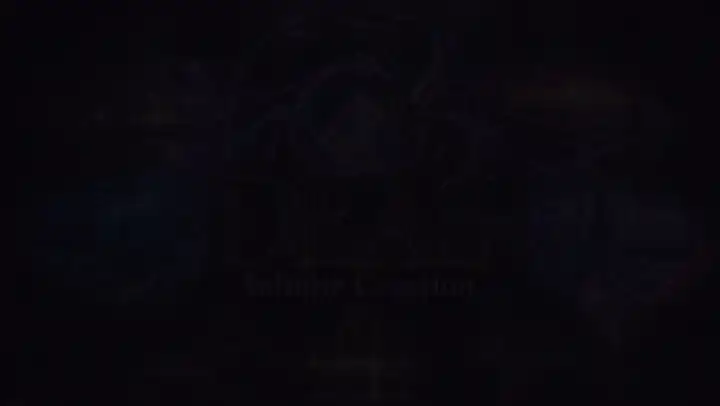

# DEAS — Dark Engine AI Studio

A Rust/Tauri desktop workstation for ComfyUI and DaSiWa tools: generation, model-aware prompting, model/resource browsing and image editing in one interface. Studio, Library, Prompt Forge, Chat, TVE, Run Plan and the original Comfy editor share the same owned backend; installation, provider authorization and settings live in the Backend tab, diagnostics in Logs.

**0.2.3 BETA.** Linux CPU/NVIDIA provisioning and individual model runs are recorded; Windows builds do not establish Windows runtime acceptance. Image, video and YuE2 music recipes exist; Linux video plays through embedded libmpv, but real-model quality and native playback acceptance are still open. TVE enhances videos through the owned ComfyUI backend (upscale model, NVIDIA RTX refine, frame generation); synchronized comparison, assembly and training are planned integrations, not completed ports. See [current status and limitations](docs/PLAN.md).

[Documentation](docs/README.md) · [Getting started](docs/GETTING-STARTED.md) · [News](docs/NEWS.md) · [Changelog](docs/CHANGELOG.md) · [Credits](docs/CREDITS.md)

[](assets/deas-ad-readme.mp4)

*Silent preview — click it for the [MP4 with sound](assets/deas-ad-readme.mp4).*

## Install and start

Check [official releases](https://github.com/darksidewalker/DEAS/releases) for platform-specific downloads and instructions. GitHub's **Download ZIP** is source, not an installed application. The beta is not a signed universal portable release.

To build from source, first install Git, Node.js 22/npm, Rust and the [Windows/Linux prerequisites](docs/GETTING-STARTED.md#before-you-start).

**Linux:**

```sh
git clone https://github.com/darksidewalker/DEAS.git
cd DEAS
bash build-linux.sh
./artifacts/deas-linux-amd64
```

`bash build-linux.sh --release` stages the release set under `artifacts/releases/v<version>/`: the Linux binary, deb/AppImage bundles (need `patchelf`), the Windows `deas.exe` when `cargo xwin` is installed (NSIS/portable bundles come from `build-windows.cmd --release` on Windows), `SHA256SUMS` and `BUILD-MANIFEST.json`. The plain build always writes the development binary to `artifacts/deas-linux-amd64`. Details: [development and builds](docs/DEVELOPMENT.md#local-linux-executable).

**Windows — Command Prompt:**

```bat
git clone https://github.com/darksidewalker/DEAS.git
cd DEAS
build-windows.cmd
artifacts\deas-windows-x86_64.exe
```

In the app, open **Backend**, review the installation, choose a **new writable environment folder**, and authorize **Start install**. DEAS manages Python, PyTorch and ComfyUI; Git and a compatible graphics driver remain prerequisites. Model weights are installed separately through Library or configured model folders. Adopting an existing ComfyUI folder is a separate, explicit option that rebuilds its venv ([Backend](docs/BACKEND.md#adopting-a-foreign-installation)). Follow [first setup and troubleshooting](docs/GETTING-STARTED.md#first-setup-inside-deas).

## Documentation

| Task | Guide |
| --- | --- |
| Generate, choose models/LoRAs, edit images, configure output/video/continuity | [Studio](docs/STUDIO.md) |
| Use prompt image references with SDXL, Qwen 2.1/Turbo, Krea 2 or MOSS | [Image references](docs/STUDIO.md#image-references) |
| Write/enhance prompts, configure LLMs, use presets and wildcards | [Prompting](docs/PROMPTING.md) |
| Discuss prompts with the configured LLM and optional web search | [Chat](docs/CHAT.md) |
| Generate songs and melody covers with YuE2 | [Music](docs/MUSIC.md) |
| Inspect and upscale a video in the TVE tab | [TVE workspace](docs/STUDIO.md#tve-workspace) |
| Use GGUF models or assign a model's architecture (**Edit meta…**) | [GGUF](docs/STUDIO.md#gguf-models-and-manual-architecture-assignment) |
| Save/reopen image drafts and import/export draft ZIP packages | [Projects](docs/PROJECTS.md) |
| Browse media, inspect metadata and preview results | [Media](docs/MEDIA.md) |
| Browse/download resources and authorize providers | [Library](docs/LIBRARY.md) |
| Manage the owned backend, startup settings, folders and language | [Backend](docs/BACKEND.md) |
| Update the DEAS application | [App updates](docs/APP-UPDATES.md) |
| Use the original workflow editor or import embedded workflows | [Comfy](docs/COMFY.md) |
| Inspect/export diagnostic logs | [Logs](docs/LOGS.md) |
| Develop or extend DEAS | [Project rules](docs/PROJECT-RULES.md), [ComfyUI rules](docs/COMFYUI-RULES.md), [development](docs/DEVELOPMENT.md) |

Detailed contracts, screenshots, verification records and planning are indexed in **[docs/](docs/README.md)**. Source and issues: [darksidewalker/DEAS](https://github.com/darksidewalker/DEAS).

## License

DEAS is free software under [GNU GPL version 3 or later](LICENSE), without warranty. Third-party code, bundled data and model/runtime resources retain their own terms; see [Credits](docs/CREDITS.md) and [Forge data provenance](src-tauri/forge-data/README.md).

## AI-assisted development

DEAS is vibe-coded with help from various local and cloud AI models, guided by human direction and planning.
