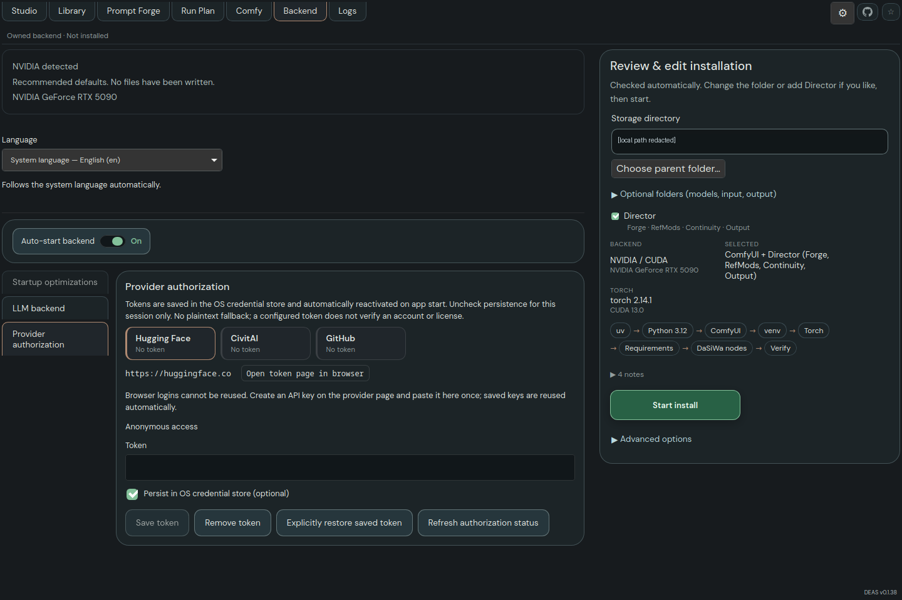

# DEAS — Dark Engine AI Studio

A Rust/Tauri desktop workstation for ComfyUI and DaSiWa tools: generation, model-aware prompting, model/resource browsing and image editing in one interface. Studio, Library and the original Comfy editor share the same owned backend; installation, authorization, Backend settings and Logs remain accessible from the header.

**Early alpha.** Linux CPU/NVIDIA provisioning and individual model runs are recorded; Windows builds do not establish Windows runtime acceptance. Video recipes exist, but native playback has a known crash. Training, dedicated video enhancement, synchronized comparison and assembly are planned integrations, not completed ports. See [current status and limitations](docs/IMPLEMENTATION-STATUS.md).

[Documentation](docs/README.md) · [Getting started](docs/GETTING-STARTED.md) · [News](docs/NEWS.md) · [Changelog](docs/CHANGELOG.md) · [Credits](docs/CREDITS.md)



## Install and start

Check [official releases](https://github.com/darksidewalker/DEAS/releases) for platform-specific downloads and instructions. GitHub's **Download ZIP** is source, not an installed application. The alpha is not a signed universal portable release.

To build from source, first install Git, Node.js 22/npm, Rust and the [Windows/Linux prerequisites](docs/GETTING-STARTED.md#before-you-start).

**Linux:**

```sh
git clone https://github.com/darksidewalker/DEAS.git
cd DEAS
bash build-linux.sh
./artifacts/deas-linux-amd64
```

**Windows — Command Prompt:**

```bat
git clone https://github.com/darksidewalker/DEAS.git
cd DEAS
build-windows.cmd
artifacts\deas-windows-x86_64.exe
```

In the app, review **AiO installer**, choose a **new writable environment folder**, and authorize **Start install**. DEAS manages Python, PyTorch and ComfyUI; Git and a compatible graphics driver remain prerequisites. Model weights are installed separately through Library or configured model folders. Do not select an existing unrelated ComfyUI installation. Follow [first setup and troubleshooting](docs/GETTING-STARTED.md#first-setup-inside-deas).

## Documentation

| Task | Guide |
| --- | --- |
| Generate, choose models/LoRAs, edit images, configure output/video/continuity | [Studio](docs/STUDIO.md) |
| Use prompt image references with SDXL, Qwen 2.1/Turbo, Krea 2 or MOSS | [Image references](docs/STUDIO.md#image-references) |
| Write/enhance prompts, configure LLMs, use presets and wildcards | [Prompting](docs/PROMPTING.md) |
| Discuss prompts with the configured LLM and optional web search | [Chat](docs/CHAT.md) |
| Save/reopen image drafts and import/export draft ZIP packages | [Projects](docs/PROJECTS.md) |
| Browse media, inspect metadata and preview results | [Media](docs/MEDIA.md) |
| Browse/download resources and authorize providers | [Library](docs/LIBRARY.md) |
| Manage the owned backend, startup settings, folders and language | [Backend](docs/BACKEND.md) |
| Use the original workflow editor or import embedded workflows | [Comfy](docs/COMFY.md) |
| Inspect/export diagnostic logs | [Logs](docs/LOGS.md) |
| Develop or extend DEAS | [Project rules](docs/PROJECT-RULES.md), [ComfyUI rules](docs/COMFYUI-RULES.md), [development](docs/DEVELOPMENT.md) |

Detailed contracts, screenshots, verification records and planning are indexed in **[docs/](docs/README.md)**. Source and issues: [darksidewalker/DEAS](https://github.com/darksidewalker/DEAS).

## License

DEAS is free software under [GNU GPL version 3 or later](LICENSE), without warranty. Third-party code, bundled data and model/runtime resources retain their own terms; see [Credits](docs/CREDITS.md) and [Forge data provenance](src-tauri/forge-data/README.md).
