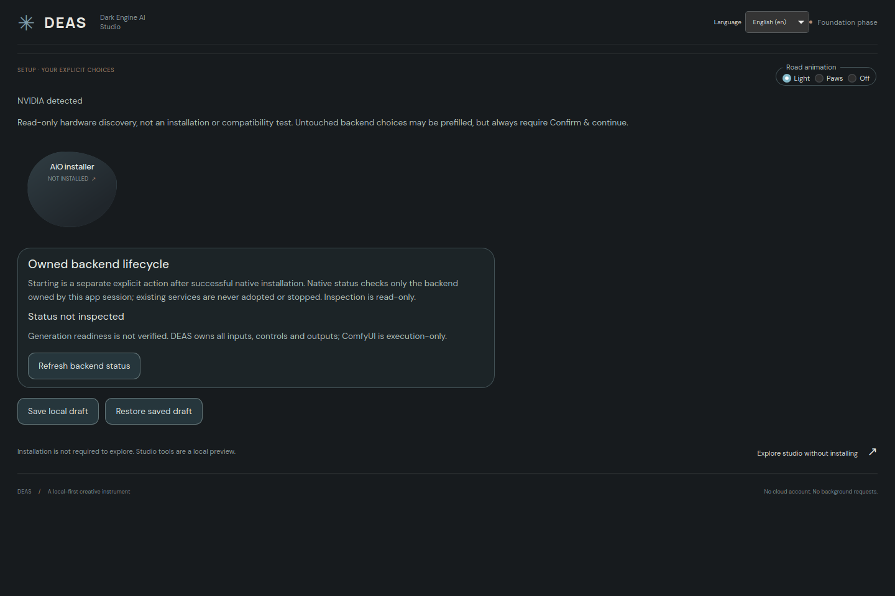
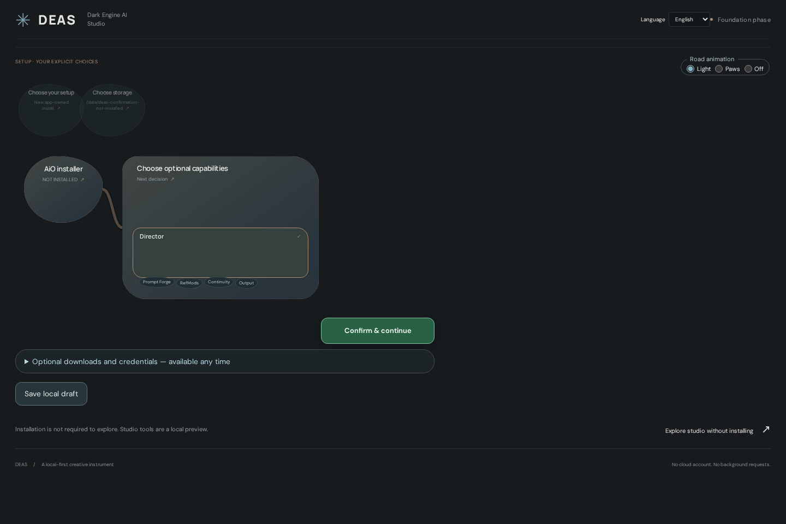

# DEAS — Dark Engine AI Studio

DEAS is a Rust/Tauri desktop studio with a single-page neural interface for ComfyUI and DaSiWa tools. Connected organic feature blobs show what belongs together; selecting a blob opens its controls within the page.

## Desktop preview



## Setup path

The first blob is the AiO installer. Clicking it reveals one compact staircase choice group. Earlier choices recede into a returnable translucent stack; active bubbles follow short snake rows. Hover/focus shows help inside reserved space in the existing bubble: no resizing, reflow or extra help bubbles. The green Confirm & continue button follows the current selection/control area at its lower-right edge, including input forms; it is not pinned to the viewport. Every setup step uses **Confirm & continue**: selecting an option, clicking a step heading or detecting a backend never advances by itself. Extra backend options stay visible until confirmation. Managed setup plans storage, explicitly selected optional capabilities and a CPU/GPU backend; the existing-backend route hands an explicit URL to the inspector. Changing an earlier decision clears incompatible later choices. Local plans can be saved/restored or exported as JSON. The native Linux x86_64 CPU/NVIDIA baseline is implemented, but a full ComfyUI installation has not been accepted end-to-end. AMD/Intel and optional Sage/Radial/Flash/FFmpeg currently block execution explicitly; there is no simulated success.

Shared `NeuralBlob`, `NeuralPath`, `NeuralGraph` and reusable `NeuralIncludedFeatures` components serve both setup and studio features. Roads offer light, moving cat paws and off modes, with reduced-motion support. See [primitive ownership and references](docs/NEURAL-PRIMITIVES.md).



## All-in-one vision — early alpha

DEAS aims to bring backend setup, resource downloads, model-aware prompting, image/video generation and editing, enhancement, training, comparison and media organization into one Rust/Tauri studio. An editable media planner should connect these operations end to end. Every feature belongs to a plugin family, and optional features must remain installable from the UX after initial setup.

Most of this is not implemented. The [plugin roadmap](docs/PLUGIN-ROADMAP.md) maps TrainFlow, TrueVideoEnhancer, DaSiWa Nodes, PromptForge and simple-video-compare into the new architecture; it is a development/collaboration plan, not a feature-completeness claim.

## Current development stage

The first milestone builds the desktop shell, interactive studio, trusted built-in feature registry and read-only ComfyUI discovery. This is **not yet the completed AiO installer or a generation-ready Director replacement**. Unavailable execution functions are identified in the interface rather than simulated.

The intended AiO product ports capabilities from the [DaSiWa ComfyUI Installer](https://github.com/darksidewalker/dasiwa-comfyui-installer) into DEAS's native Rust engine. It does not bundle or launch an external Go installer. ComfyUI is the baseline; Director is one explicitly selected package including Prompt Forge, RefMods, Continuity and Output. Small passive microbubbles show these included parts; they are not separate optional choices. Suggested/Detected are translated badges only, without recommendation connection lines. Hardware preselection still requires step confirmation. UX languages are data-only plugins with decentralized per-module text resources. Python/PyTorch continue to execute workflows; driver compatibility and model licenses remain explicit prerequisites.

## Execution-only backend

DEAS owns every feature selection, input/settings control, media reference, job view and output playback/export. ComfyUI receives dynamically compiled API-format jobs and executes them; internal computational nodes do not define or supply the studio UX. No embedded node editor or custom-node frontend is used. A verified SDK/API adapter is preferred, with explicit endpoint binding and no automatic cloud fallback. See [execution contract and API roadmap](docs/EXECUTION-CONTRACT.md). The desktop Engine panel now offers a separate read-only execution-API check. It probes the documented v2 proxy health and protected job listing; Classic queue inspection is selected only when the optional v2 health route returns 404. Authentication, redirects, malformed responses and incompatible contracts remain visible failures. Browser preview fails closed for this native-owned operation. A pure versioned diagnostic checkpoint text-to-image compiler validates explicit intent and supplied verified node/model/sampler/scheduler lists, then builds a deterministic immutable API graph. This is not a Director/video recipe or a submission path. Dynamic recipe submission and real generation remain unfinished.

## Optional downloads and provider authorization

Separate inline plugins are accessible from setup and the studio plugin area, independently of baseline installation. A strict native TOML catalog feeds the UI; add resources/providers in `src-tauri/downloads/default.toml` or explicitly import an additive catalog for the current session. Browse HF users/model/dataset repositories, CivitAI creators/models, GitHub accounts/repository files, configured HTTPS direct/index sources or an explicitly configured loopback Ollama tags endpoint. Repository listings lead to explicit repository browsing; Ollama tags never imply a pull or downloadable file.

Provider tokens are optional and origin-bound. Session memory is default; OS-store persistence/restoration is explicit and never falls back to plaintext. Downloads use their own immutable plan, native parent-folder selection, a new destination subfolder and separate unchecked consent. Staged files are inert data, not installed models or executed workflows. Linux scratch HTTP transfers and UI/IPC fixtures are tested; live authenticated providers, real OS-store operation, large-download resume and Windows writes remain unverified/unsupported. See [catalog examples, contracts and limits](docs/DOWNLOAD-PLUGINS.md).

## Language plugins

German, English, Turkish, French, Simplified Chinese and Japanese menus/texts live in decentralized module-owned `locales/*.json` files. Data-only manifests under `src/languages/<id>/manifest.json` register bundled UX languages. Switching language preserves IDs and choices; key parity and source-reference checks run in tests. Raw technical logs/errors remain original. See [localization contract](docs/LOCALIZATION.md).

## Native installer coverage

Rust directly implements verified uv bootstrap, managed Python, isolated venv, ComfyUI reference checkout, pinned CPU/NVIDIA Torch selection and required runtime checks. Selected DaSiWa capabilities share one nodepack dependency, fetched only when needed; selecting a capability does not yet implement its studio UI or install model weights. Plans fix hardware and framework identities and require separate confirmation. Targets must be absent, with an existing nonsymlink parent. Existing environments are never wiped or changed.

Successful native provisioning in the current app session authorizes a separate explicit owned-backend start. Lifecycle commands verify exact child/listener ownership and real bounded ComfyUI API responses, expose status/logs and stop only the owned process group. They do not adopt arbitrary existing targets or imply generation readiness. Linux local-process/HTTP fixtures are verified; a full newly installed ComfyUI stack and NVIDIA service launch remain unverified.

Read [the port ledger](docs/INSTALLER-INTEGRATION.md) and [native IPC details](src-tauri/README.md) for unsupported options and verification limits. Source-only node dependencies remain unverified. Full Go-installer parity is unfinished.

## Development

Requires Node/npm, Rust/Cargo and Tauri's platform build dependencies. On Linux the desktop runtime uses WebKitGTK, so browser tests alone do not prove native media support.

```sh
npm install
npm run typecheck
npm test
npm run build
npm run dev
```

Desktop development and packaging:

```sh
npm run tauri dev
npm run tauri build
```

The frontend development server uses port 1420. Engine discovery is an explicit read-only action; the initial local endpoint is `http://127.0.0.1:7801`. Connect to a compatible ComfyUI API, not an authenticated HTML login page. Browser mode may require backend CORS configuration; the native shell uses bounded Rust HTTP requests.

## Local Linux executable

The initial locally verified executable is `artifacts/deas-linux-amd64`. On this host, native rendering was verified with:

```sh
env WEBKIT_DISABLE_DMABUF_RENDERER=1 ./artifacts/deas-linux-amd64
```

It embeds the frontend and does not require a Vite server. It still requires compatible Linux system/webview libraries; this is not yet a signed portable AiO release. See [verification and limitations](docs/VERIFICATION.md).

Browser acceptance checks can be repeated with a Python environment containing Playwright and Pillow:

```sh
python tools/verify_ui.py http://127.0.0.1:1420
python tools/verify_confirmation.py
python tools/verify_help.py
python tools/verify_stability.py
python tools/verify_api.py
```

## Architecture

- **React/TypeScript:** neural studio, local authoring state and feature manifests.
- **Rust/Tauri:** desktop integration, narrow native commands and native provisioning.
- **Go installer source:** read-only reference for the Rust port; no external installer process.
- **ComfyUI + DaSiWa nodes:** model execution and media processing.

Feature discovery does not guarantee a workflow is ready: model presence, GPU execution and complete recipe validation are separate future checks. Built-in manifests are trusted code, not a sandbox for downloaded plugins.

## Safety

Development does not install models, alter existing ComfyUI environments or stop running user services. Full managed setup and updates will require an explicit plan and preserve projects, models and media. DEAS must only manage backend processes it owns.

## Plan

See [the milestone plan and acceptance checklist](docs/PLAN.md). Verified outcomes and explicit limitations are recorded in `docs/VERIFICATION.md`.

## Repository

Source and collaboration: https://github.com/darksidewalker/DEAS
