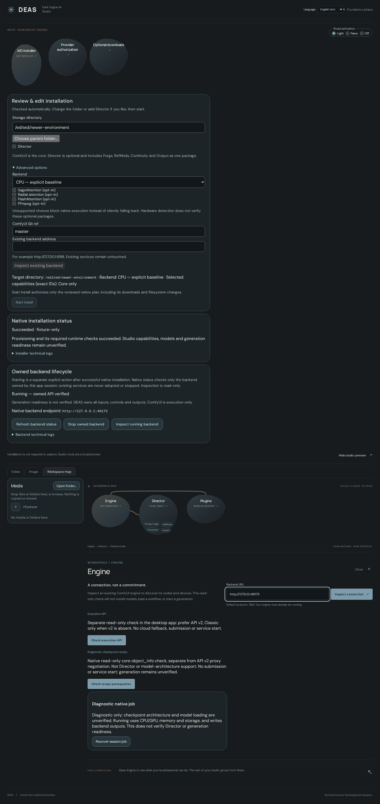

# Installer, backend, folders and language settings

[Documentation index](README.md) · [Current implementation status](IMPLEMENTATION-STATUS.md)

## Setup path

Setup is one automatic path. Header actions open installer, authorization, Backend and Logs; Studio, Library and Comfy share the tab band. Setup remains accessible after installation. The Installer tab shows the hardware findings, and a sticky **Review & edit installation** panel on the right holds the storage folder, the Director package (checked by default; Forge · RefMods · Continuity · Output are included parts, not separate choices), a dense plan summary with the step chain, collapsed native warnings and the single green **Start install** authorization. Backend, optional packages, the ComfyUI Git ref and an existing-backend address live under Advanced options. The native plan re-prepares automatically after every edit; any edit invalidates the prepared plan, and choices lock during execution. Managed setup defaults to a new `deas-environment` directly beside the running executable, selects a compatible NVIDIA profile or an explained conservative CPU recommendation, and leaves optional packages/extensions off. The native Linux x86_64 baseline installs ComfyUI directly. Full new CPU and NVIDIA installations, framework computation, owned backend start, real API readiness and stop are verified on Linux. AMD/Intel and optional Sage/Radial/Flash/FFmpeg currently block execution explicitly; there is no simulated success.

Shared `NeuralBlob`, `NeuralPath`, `NeuralGraph` and reusable `NeuralIncludedFeatures` components serve both setup and studio features. Historical animated-road settings are not the current setup contract; preserve reduced-motion behavior and avoid continuous repaints. See [primitive ownership and references](NEURAL-PRIMITIVES.md).

## Folder selection and relocation

Native folder selection resolves symlink aliases to their real existing directories before planning; installation execution still refuses symlink substitutions. The first installation review offers optional existing models, input and output folders. They remain an in-memory draft until Start install authorizes the immutable plan; no folder settings or data are written by selection alone.

Relocation currently supports Linux; other platforms reject movement without changing files. After installation, the Settings tab separates saving paths from the explicitly selected **Move files & save folders** action. Moving checks all changed trees for conflicting filenames before copying; it never overwrites a destination file. Close other applications using these folders, stop the owned backend and finish downloads first. Copies are verified before settings are switched and originals removed. Errors preserve original data; cleanup warnings identify retained duplicates. Symlinks inside relocated trees and overlapping trees are rejected rather than followed.

## Language plugins

German, English, Turkish, French, Simplified Chinese and Japanese menus/texts live in decentralized module-owned `locales/*.json` files. Data-only manifests under `src/languages/<id>/manifest.json` register bundled UX languages. Switching language preserves IDs and choices; key parity and source-reference checks run in tests. Raw technical logs/errors remain original. See [localization contract](LOCALIZATION.md).

## Native installer coverage

Rust directly implements verified uv bootstrap, managed Python, isolated venv, ComfyUI reference checkout, pinned CPU/NVIDIA Torch selection and required runtime checks. Selected DaSiWa capabilities share one nodepack dependency, fetched only when needed; selecting a capability does not yet implement its studio UI or install model weights. Plans fix hardware and framework identities and require separate confirmation. Targets must be absent, with an existing nonsymlink parent. Fresh installs refuse existing targets. Explicit owned-environment Upgrade/Reinstall is separate: review its plan; reinstall can replace the owned venv and is not rollback.

Successful native provisioning or checked reopening authorizes the owned backend. It auto-starts by default after installation/open and on app restart; disable **Auto-start backend** in **Settings** for explicit manual startup. Manual Stop is not automatically undone. Native manifests and launch files are checked before reuse, and an OS-held environment lock prevents another DEAS instance from starting the same environment. Lifecycle commands verify exact child/listener ownership and real bounded ComfyUI API responses, expose status/logs and stop only the owned process group. They do not adopt arbitrary existing targets or imply generation readiness. Linux local-process/HTTP fixtures and full newly installed CPU/NVIDIA ComfyUI stacks are verified, including an RTX 5090 CUDA computation and owned service launch.

Read [the port ledger](INSTALLER-INTEGRATION.md) and [native IPC details](../src-tauri/README.md) for unsupported options and verification limits. Node requirements explicitly resolve NVIDIA VFX wheels and select backend-specific llama-cpp-python binary wheels, following the reference installer; unavailable wheels fail without a source build or silent CPU fallback. Complete selected nodepack installation, required Director/Continuity registration and owned API lifecycle are verified on the RTX 5090; model generation and every included feature recipe remain separate acceptance work. Full Go-installer parity is unfinished.

## Backend lifecycle and startup settings

After successful installation/checked reopening, Backend provides Start/Stop/Restart and Auto-start, enabled by default. Disabling it does not stop a running process; manual Stop is not automatically undone. Only owned processes are managed; an HTTP listener is not adopted.

Startup optimizations are distinct from per-job Options. Speed+, Compatibility, Off and Custom select validated hardware-qualified launch flags. Review attention/fast features, VRAM/reserve, VAE and advanced precision/cache settings before Apply. Package-dependent choices require their actual packages. Apply can restart the owned backend and is blocked while a job is active; it is not read-only. These presets are not a measured optimization scan. See [source](../src-tauri/src/startup.rs), [LLM settings](PROMPTING.md#shared-llm-backend) and [verification](VERIFICATION.md).

## Changes and troubleshooting

Follow [first setup](GETTING-STARTED.md#first-setup-inside-deas) for storage/models/consent. Driver and Git remain external prerequisites. Unsupported profiles/options and missing resources block execution. Read [Logs](LOGS.md); never delete existing environments or stop foreign services to clear a blocker. Full repair/resume, staged rollback and broad hardware/Windows acceptance remain incomplete.
