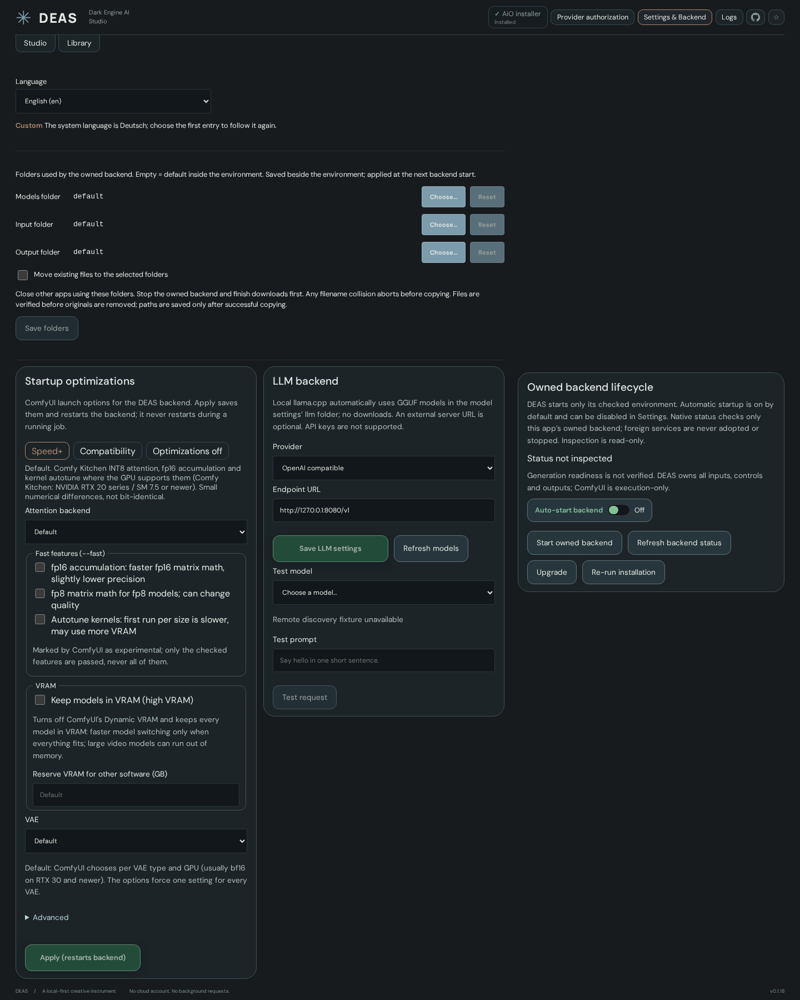

# Prompt Forge, LLM settings, presets and wildcards

[Documentation index](README.md) · [Current implementation status](IMPLEMENTATION-STATUS.md)

## Shared LLM backend

After installing or reopening a DEAS environment, select **Backend → LLM backend** in the left-hand configuration menu. Configure only an optional Ollama server (such as `http://127.0.0.1:11434`) or OpenAI-compatible API (such as `http://127.0.0.1:8080`; `/v1` is appended when missing, like the DaSiWa node pack does). There is no global model or GGUF-path setting.

Local language GGUFs are discovered recursively in the existing **Models folder → llm** directory (by default `<environment>/ComfyUI/models/llm`), independently of any external server. Projector files such as `mmproj` are excluded. `llama-cpp-python` runs the selected local model automatically in the managed venv, with automatic CPU/GPU offload selection, and the worker exits after each request. Optional remote model discovery adds to the local list; an unavailable remote server does not hide local models.

**Test model** lists discovered local and remote models together and chooses a model only for that test request, without saving a default. A failed request never silently switches to another model. Opening settings reads model lists but never generates text. No server, package or model is installed or downloaded by this panel. API-key authentication remains separate work.

If an LLM entry point (including Prompt Forge, inline writers and Director/Continuity helpers) is clicked without a configured endpoint or discoverable local language model, DEAS opens **Backend → LLM backend** with setup guidance instead of an empty writer. The source draft stays mounted. This navigation does not download, start a model or submit text/media. A configured service's connection failure remains an error, not evidence that configuration is missing. Before an environment has been installed/opened, Backend explains that prerequisite; runtime LLM settings cannot be used without one.

## Prompt Forge

Prompt Forge writes or enhances prompts in the dialect of the selected model. It has two engines:

- **Image models — Illustrious (SDXL), Anima, Krea2 and MOSS — run natively in DEAS.** This is PromptForge's own pipeline: before writing, the characters a brief names are matched against the local tag database and their canonical look (hair, eyes, ears, build — never clothing or props) is taken from the local character table; while writing, the model can call `search_tags` to look up real Danbooru tags with post counts (Illustrious, Anima) and `read_guidance` to open Anima's reference documents, within 3 rounds and 24 calls; afterwards the `===SEGMENT:` contract is enforced and the result cleaned mechanically — duplicate and invented `name_(series)` tags removed, the model's registry negative defaults restored, negatives that contradict the positive dropped, literal parentheses escaped, leaked aspect ratios and stray underscores removed, kept-verbatim text put back. Tool calls and every clean-up are written to **Logs**. Nothing goes online except the request to your LLM server.
- **MiniMax H3, Wan 2.2 and LTX 2.3 run in the DaSiWa node pack** on the owned backend (the H3 Director's Forge and the **LLM Prompt Writer** node), as before.

**Requirements for the native writer:** an Ollama or OpenAI-compatible server (llama.cpp, llama-swap, vLLM) under **Backend → LLM backend**; the local GGUF runner cannot call tools yet and the writer says so. The model id is the server's own. Thinking is switched off per request (`think: false` / `chat_template_kwargs.enable_thinking: false`); Ollama gets a 32k context. Data lives in `<environment>/forge-data` (or `DEAS_FORGE_DATA`): `forge-pack.json` (PromptForge's prompts, tool definitions and settings, exported by its own loaders — see `tools/export-forge-pack.mjs`), `tags.sqlite`, `character_traits.sqlite`, `character-corrections.json` and `randomizer.json` (the Randomizer's vocabulary, copied from PromptForge's `config/randomizer.json`). Without the databases the writer still runs, with tools, canon and tag checks off.

- **Hammer in the prompt field (Generate):** choose LLM Prompt Forge or Wildcards. For an image model it is a one-click rewrite of the current prompt through the native writer (no extra controls). In Image to Image and Inpaint the source picture still goes to the node writer, which lets a vision model read it (a model without vision writes from the text and says so). The result is shown for review, applied on **Apply**, and keeps one **Undo**. With Wildcards active, the idea starts as the current prompt plus the resolved picks (node pack 0.5.31 or newer), so the LLM writes around them. Families without a prompt dialect disable only the LLM mode; wildcards need no LLM.
- **Prompt Forge tab, image models:** the main prompt editor, laid out like PromptForge's builder. **Build** (left) holds **Write for** (Illustrious, Anima, Krea2, MOSS) and the LLM model, MOSS's **Format** switch (Natural language or Layout JSON; Hybrid is held back while it is still being tested), the brief, and **Detail** and **Creativity** sliders that name every notch. Below them are folding sections; each remembers whether it is open, and when closed it says in its header what is set inside. **Open all / Close all** works them together.
  - **Setting presets:** Quality preset and Style as chips (Krea2 styles are pasted word for word after writing), Aspect as shape tiles.
  - **Output:** Length — Default (the model decides), *words* (asked for, not enforced) or *tokens* (a hard cut-off, roughly 0.75 words per token), 10 to 4000 — and the switches **Write a negative prompt** and **Explain what it wrote**.
  - **Kept as written:** Custom positive and Custom negative, kept verbatim (trigger words, artist tags).
  - **Camera:** icon tiles for **Angle** and **How close**, drawn from PromptForge's own camera tables in this model's dialect (tags or prose).
  - **Lighting:** a **Lighting** slider from 0 Off to 10 Radiant (0 sends nothing; any other level is sent as an exposure instruction) and **Light from** tiles.
  - **Tags:** search the local tag database as you type (categories coloured, post counts shown), pick tags into pills that are kept exactly in the prompt, click a pill to weight it (Illustrious and Anima), and after picking a character, click in their traits from the local character table or **Add all**. Picking tags turns off automatic character matching for that write, as in PromptForge.
  - **Randomizer** (header button): tick whole boxes or the pieces inside them, set how many women and men, optionally **Controlled chaos** (how many pieces of each box to use), then **Roll** or **Surprise me** (picks the categories too; never NSFW unless you tick it). The preview is editable; **Add to brief** or **Replace brief**. No model is involved; the vocabulary is `forge-data/randomizer.json`.

  **Result** (right) shows an empty state until something is written. Then the prompt and the negative are editable, and **Refine** (type one change; everything else comes back word for word), **Second pass** (the model revises its own draft against the brief; slower) and **Undo** (one step per revision) work on the draft as it is on screen. **Copy all** and **Clear** sit in the header. The report under the result names the characters matched, how many tag lookups ran, what was cleaned and how many sections a revision rewrote. **Send prompt to Generate** keeps Generate's own negative; **Send prompt + negative** replaces it. Settings are remembered per model. Pictures, the MOSS Layout Studio and the Anima labelled format are not in the native editor yet.
- **Prompt Forge tab, video models:** Wan 2.2, LTX 2.3 and MiniMax H3 through the node pack, with Detail and Creativity, reference pictures from the input folder (read by a vision model), and **Send to Generate** for the prompt and an optional negative prompt. H3 offers T2VA, I2VA, FL2VA, L2VA and REF2VA with Duration, Shots and labelled pictures (Character 1–4, Place, Style, First/Last frame); H3 Generate has a separate bounded recipe; Forge offers more modes than generation currently supports. See [video generation](STUDIO.md#video-generation).

Baseline writers need DaSiWa node pack 0.5.30 or newer on the backend (**Backend → Upgrade**); Director features additionally need their corresponding Forge/Cast/people routes. The **Generate hammer** supports bounded H3 Cast/scene/pose cards, people boxes, explicit Cancel and run-context references; see [Studio controls and limitations](STUDIO.md#prompt-controls). These additions do not extend the separate Prompt Forge tab. The Generate hammer also accepts manually assigned first/last-frame character cards for I2VA/FL2VA/L2VA; generation graphs remain unchanged. Streaming, automatic card reading and continuity drafts remain planned.

## Continuity Next action (checkpoint sources)

In the H3 Continuity overlay, the next runnable step with a known checkpoint source offers the existing Prompt Forge hammer. Its brief is Next action; applying the result changes only that step. Source/session, overlap, current action, step seconds and canvas travel with the request, and context/model/backend changes invalidate a draft. Review, history, undo and cancellation remain explicit. Plan/run controls lock during writing, and closing Continuity cancels its owned request. The backend supplies source-tail evidence when the model/runtime permits it; missing-image warnings mean text-only context, not verified vision. No additional timeline references are supplied in this bounded checkpoint path. A prepared backend-input video now uses the same review flow with `source_kind:video` for the first extension; later steps use their generated checkpoint predecessors. Local uploads and use-references remain separate work. Actual local-model/source-tail quality remains unverified until a consented real run.

## Presets

Generate has independent **Presets** and **Wildcards** dock tabs. Presets need the desktop app, but no running backend, LLM or node-pack installation. Enter a name and choose **Save as new preset** to retain the current live Studio controls, including unsaved changes. Select a saved preset and choose **Load preset**; edit the normal Studio controls, then **Update selected preset** to replace that preset after confirmation, or enter a different name to save another copy. Existing names cannot be silently overwritten by Save as new.

Presets include prompts, selected model/component filenames, LoRAs, pipeline, resolution/scaling, sampler/steps/CFG, seed and random/fixed mode, image/inpaint settings, video controls, post-processing, Options and wildcard rules/activation. They exclude media/input files, references/people assignments, masks/layers, continuity sessions, seed history, layout, backend/folder/auth configuration and project/job identity. Random seed mode remains random; a preset is not a promise to reproduce a random generation. Loading never starts execution, replaces media or saves a project automatically. Normal model availability and generation validation still apply; unavailable files must be supplied or selected before running.

Up to 100 presets are stored in an app-local JSON file through the native service (2 MiB total limit, names up to 100 characters). They survive restarts independently of Studio reset and project/global draft scope. They are not bundled media/project archives or exported packages. Prompt text is stored locally in plaintext: do not put secrets in prompts. Invalid/incompatible settings are rejected as a whole; read/write failures remain visible and are recorded in shared Logs without preset contents. A corrupt file is not overwritten by an empty fallback. Linux/Windows use the same native persistence path; Windows runtime acceptance remains unverified.

## Wildcards

Generate's **Wildcards** dock tab sits beside LoRAs and also opens from the hammer. It reads the installed DaSiWa node's library, with searchable categories, independent preset/wildcard selections and weights, Booru/natural-language style, its own seed and an estimated token budget per positive/negative side. Positive/negative placement follows the original library categories.

Activation is opt-in and remembered with the rules. Manual or Forge-written prompts remain the base text; the original `DaSiWa_WildcardPresetPromptBuilder` runs before both text encoders and appends the selected fragments. **New picks** rerolls alternatives; **Random select** explicitly replaces the selection with 1–10 available entries. **New picks on every generation** rerolls alternatives only, never the selected subjects. The original node handles weighting, category order and budget pruning; DEAS has no second prompt-expansion engine.

An active badge beside the prompts opens the rules; **Disable wildcards** stops applying them without clearing the selection or base text. Job metadata records the submitted rules independently of later edits; **Use these settings** restores a job's rules, while applying ordinary image metadata disables augmentation to avoid adding it twice to an already resolved prompt. With the DaSiWa metadata saver installed, output PNG metadata receives the exact evaluated positive/negative strings. The text fields and job intent show base text, not a prediction of a future random pick. Missing library/node support reports an error instead of silently dropping active rules. Custom libraries remain managed by the node pack; after changing its file, restart that backend as documented by the node.

## Troubleshooting and boundaries

Review Backend → Upgrade for missing node-pack routes; this changes only the approved owned environment. Check discovery, selected model/provider and vision support when requests fail. Active wildcards require their library/node and fail closed. Writer output is a suggestion for review, not quality/adherence proof. Keep secrets out of prompts/reports. See [Logs](LOGS.md) and [verification](VERIFICATION.md).
