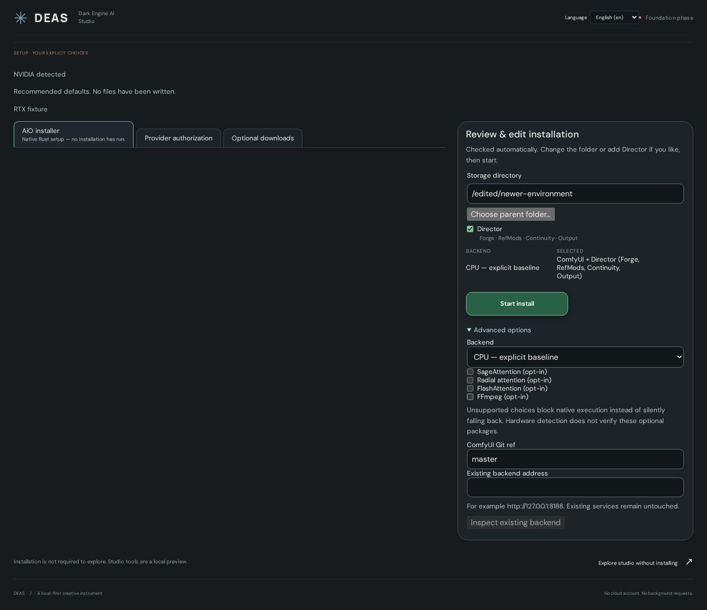

# DEAS documentation

[Documentation index](README.md) · [Current implementation status](IMPLEMENTATION-STATUS.md)

## Start and use DEAS

Studio settings: [Presets — save, load and update](PROMPTING.md#presets) · [Wildcards](PROMPTING.md#wildcards).

| Feature, tab or action | Guide |
| --- | --- |
| Installation, Windows/Linux build, launch and first setup | [Getting started](GETTING-STARTED.md) |
| AiO installer, Backend lifecycle, startup settings, folders and language | [Backend and settings](BACKEND.md) |
| Confirmed application-binary updates, manual restart and platform limitations | [Application updates](APP-UPDATES.md) |
| Studio → Generate, model/LoRA docks, Options, image editing, post-processing, metadata and H3 Continuity | [Studio](STUDIO.md) |
| Native image-draft projects, autosave and managed PNG input (not job/result recovery) | [Projects](PROJECTS.md) |
| Studio → Prompt Forge, hammer, presets/wildcards and shared LLM settings | [Prompting](PROMPTING.md) |
| Studio → Chat: conversation, prompt writing, model guides, tag lookups and optional web search | [Chat](CHAT.md) |
| Studio → Run Plan (Ablaufplan) and legacy Engine diagnostics | [Run Plan](STUDIO.md#run-plan-and-engine-diagnostics) |
| Media dock, navigation, preview and embedded metadata | [Media](MEDIA.md) |
| Library → Catalog / Installed and provider authorization | [Library and authorization](LIBRARY.md) |
| Original Comfy editor and workflow import | [Comfy tab](COMFY.md) |
| Logs, source/level/search filters, copy/export | [Logs](LOGS.md) |

## News, history and attribution

[News](NEWS.md) · [Changelog](CHANGELOG.md) · [Credits and upstream notices](CREDITS.md)

## Architecture and contributor contracts

- [Accepted product/architecture decisions and first image-project milestone](PRODUCT-DECISIONS.md) — binding target contract, not implementation evidence
- [Project rules, goals and dependencies](PROJECT-RULES.md)
- [ComfyUI integration/coexistence rules](COMFYUI-RULES.md)
- [Consolidated current status and implementation plan](IMPLEMENTATION-STATUS.md)
- [Video, references and Director parity — working plan](VIDEO-PLAN.md)
- [Development, builds and diagnostic API](DEVELOPMENT.md)
- [Windows/Linux path contracts, audit and tooling limits](PATH-COMPATIBILITY.md)
- [Bundled PromptForge data updates and weekly review PRs](FORGE-DATA-UPDATES.md)
- [Execution ownership and trust boundaries](EXECUTION-CONTRACT.md)
- [Installer integration ledger](INSTALLER-INTEGRATION.md) and [native IPC reference](../src-tauri/README.md)
- [Download catalog guide](DOWNLOAD-PLUGINS.md), [download plugin contract](DOWNLOAD-PLUGIN-CONTRACT.md), [authentication contract](AUTH-PLUGIN.md)
- [Localization contract](LOCALIZATION.md) and [neural primitives](NEURAL-PRIMITIVES.md)
- [Verification journal and known limitations](VERIFICATION.md)

[PLAN.md](PLAN.md), [PLUGIN-ROADMAP.md](PLUGIN-ROADMAP.md) and [NEXT-SESSION.md](NEXT-SESSION.md) retain historical/detail context. Current status comes from the consolidated index, not old checkbox totals. Training, dedicated comparison, video enhancement and assembly remain planned ports; see their source-specific acceptance criteria there.
