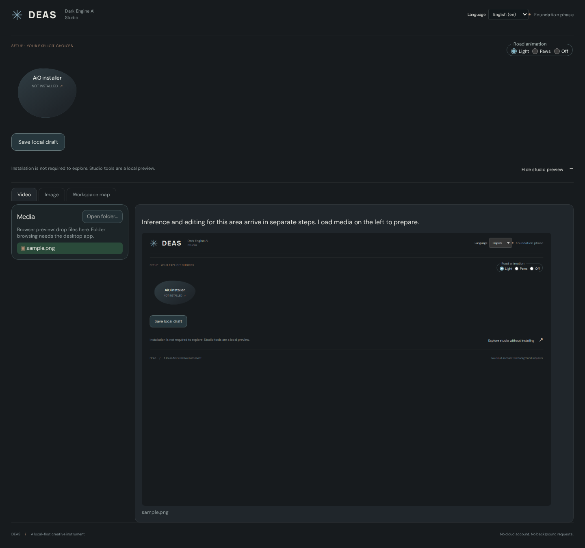
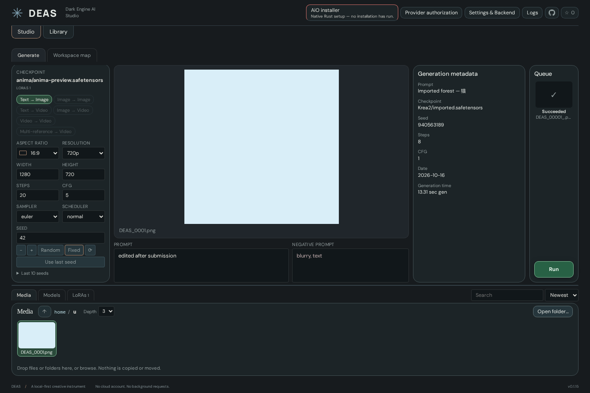

# Studio: generation, editing and output

[Documentation index](README.md) · [Current implementation status](IMPLEMENTATION-STATUS.md)

## Studio preview

A successful approved installation opens the studio with **Generate**, **Prompt Forge** and **Run Plan** tabs. Generate has a **Pipeline** dropdown at the top of the settings column (Text → Image, Image → Image, …; pipelines without a runnable model are greyed out), model-family selection, LoRAs, prompts, a session queue and a resizable Media/Models/LoRAs dock; the Models and LoRAs tabs show a subfolder tree of the models folder that filters the tiles. The dock's **View** picker switches Media, Models and LoRAs between **Tiles**, **Large thumbnails** and a **List** (one choice for all three, remembered); tiles print two lines of the name (models without folder and file extension), the full name stays in the tooltip. Whatever still blocks Run — no picked image, no painted mask, a source outside the model grid — is named on the preview itself; **✕** in the preview's top-right corner closes the preview and drops the selected image or job. Image recipes and, for LTX 2.3, Wan 2.2 and MiniMax H3 models, **Text → Video** / **Image → Video** share the same controls; Video → Video and Multi-reference stay visible but disabled. The media library accepts drops and native folder browsing; selecting media loads its preview. The workspace map shows the Engine, Director and plugin hierarchy.

### Post-Processing

Generate's **Post-Processing** dock tab is the SwarmUI Refine / Upscale step. **Refine / Upscale after every run** (off by default) adds a second pass to each Run: an optional upscale model from the configured `upscale_models` folder, a lanczos resize by the **Upscale factor** (1–4, each edge snapped to the model's grid), then resampling with the same model, prompts and seed at the **Refiner strength**. **Post-process** sits in the preview toolbar while **Image to Image** or **Inpaint** is active and applies that step alone to that picture (the edit source or the shown render), without a new first generation. Other pipelines do not offer it, because their active model may not be an image model. The image edit buttons are **Image to Image** and **Inpaint**; the settings column names the input picture by file name only (folders and the `[output]` suffix are in its tooltip); refine and upscale moved into this tab.

**Tiled refine (DaSiWa Tiled Diffusion)** samples that second pass in overlapping latent tiles instead of one large latent. The tile is the picked model's native size (SDXL 1024×1024, LTX 1280×704, …) snapped to its grid, the overlap an eighth of the shorter tile edge (at least 64 px); the `DaSiWaTiledDiffusion` MODEL patch runs every denoising step tile by tile and blends the overlaps with positive pyramid weights, so there is no seam to fix afterwards. The toggle is enabled only when the backend lists that node (DaSiWa node pack); the first pass stays untiled. ControlNet is not supported on the tiled pass.

### Image editing

Drag an Input/Output image from the Media dock onto the picture to insert it where you drop it. Select its layer thumbnail to move it, resize its corner with aspect preserved, or use arrows / + / − / Delete. Image layers can be hidden, reordered and removed; only visible inserts are submitted (up to four). The base image is locked. Inserts currently composite opaquely; transparent cutouts are not supported.

With an image layer selected, **Brush**/**Erase** paint on that picture in its own pixels: a colour field, hex value and a palette of standard colours sit in the toolbar. Run flattens painted layers to PNGs, uploads them like masks and pastes the flattened picture instead of the original file.

**Inpaint** provides up to four independent mask layers with selectable thumbnails, Brush/Erase, a synced diameter slider and number field (1–1024 source pixels; Ctrl+mouse wheel resizes the brush while Brush/Erase is active), round/square brushes and a black–white **Mask value** slider (white = full repaint, default). Clear affects the selected mask. Visible masks combine into one white-repaint/black-preserve PNG; overlay opacity (value shown beside the slider; it snaps to 10, 25, 50 and 75 % when dragged within 3 % of them) changes only its display. **Magic wand** adds the connected area of similar colour around the click to the selected mask, Alt+click removes it; **Tolerance** (0–255, default 32, per RGB channel against the clicked pixel) sets how far the area grows, so it stops at visible edges. It reads the source picture only, not inserted layers. Wheel zoom follows the cursor; Fit, 100%, zoom buttons and Pan/middle-drag change the view, never source coordinates. Masks can be raised/lowered like image layers; the exported mask is their union, so the order is cosmetic.

**Inpaint only masked** is opt-in. **Mask Shrink Grow** adds 0–512 source pixels of context around the visible masks (default 8 when enabled); 0 still enables a tight crop. The crop is processed at the active model's native pixel budget with model-aligned dimensions and its own aspect ratio, then resized back and composited into the original full-size image. Larger margins give more surrounding context; smaller margins concentrate detail. The crop also includes the finite blur support so softened edges are not clipped.

**Mask Blur** accepts integer radii 0–31 (default 4; examples: 0, 4, 8, 16), using the same Gaussian kernel and sigma as SwarmUI, limited to the core ComfyUI node’s supported radius (31 rather than SwarmUI’s 64). It softens both the sampling mask and final blend. Default 0 disables it, independently of crop mode. Both options appear only in Inpaint, preserve inserted image layers and use core ComfyUI nodes without an extra node pack.

Entering or leaving side by side (after Run of an edit) refits the editor picture into its column, also after zooming. While Image to Image or Inpaint is active, every queue entry you pick opens beside the editor, so masks and edit controls stay visible. Picking an edit job when no draft is open (after ✕ or after browsing another picture without masks or inserts) brings its source picture and mode back into the editor; masks closed with ✕ are not restored. In **Slider** compare the wheel zooms both pictures together at the cursor, middle-drag pans, double-click resets; the divider stays put. **Slider** (compare) and **Full view** sit with the edit buttons on the left of the render's toolbar. Clicking a render or a browsed picture (or **Full view**) opens it over the whole window: the wheel zooms at the cursor, dragging pans, Fit/100 % reset the view, Escape or ✕ closes it. The edit draft survives Generate/Workspace map and top-level tab switches, edit-mode changes and reviewing queue results. **Return to edit draft** restores it after submission. Selecting another source resets the draft; masks are not saved across application restarts. Clear/delete have no undo. Inpaint refuses source sizes outside the selected model family's resolution grid rather than silently changing pixels; resample first. Submitted mask/insert snapshots do not change when the draft is edited during upload. The originals are never overwritten.

### Generation metadata

When a selected local image or video contains an embedded ComfyUI editor workflow, **Open in Comfy** loads it into the existing **Comfy** tab as a named workflow. The current unsaved editor draft remains available. This requires the running DEAS-owned backend and never queues generation; use Comfy's own Run control when ready. Missing models/custom nodes are handled by the original editor. API-only `prompt` metadata does not contain the original layout and is not offered as an embedded workflow.

The **Metadata** button in the preview's top strip (shown while an image or job is selected) opens a scrollable panel over the right side of the preview; it stays open while you browse until you click the button again. It shows the selected session job's submitted prompt, negative prompt, model, dimensions, seed, steps, CFG, sampler/scheduler and any separate encoder/VAE, LoRAs or image-to-image input/denoise. These values come from the immutable native job, not the currently edited controls. Execution date and duration are shown only when matching backend history timestamps are available, alongside the DEAS version. Selecting a browsed or OS-dropped local image reads its embedded PNG text, JPEG comments/EXIF or WebP EXIF/XMP into the same column. Swarm parameters become fields; ComfyUI API graph inputs are listed with their node names; A1111 and unfamiliar text remain intact. Missing metadata and read errors clear previous values. Reads are bounded and never rewrite the image or apply settings. Browser-only blob drops and other image containers are not supported for metadata. Unreported backend details are not inferred.

### Resolution and reference scaling

Generate has aspect and resolution pickers with automatic reference aspect only for media-input pipelines, Director ratios plus ultrawide/portrait formats, custom ratios, one native/model-default resolution derived from the active model family, resolution/megapixel presets through 4K, custom megapixels and exact width × height. Preset names use the Director pixel-budget convention, not a guaranteed fixed vertical edge. Steps, CFG, Denoise, Mask Shrink Grow and Mask Blur have a slider under their number field; both edit the same value. Dimensions snap to the selected family’s declared grid (SDXL 64, H3/LTX 32, Wan 16); entering width/height explicitly overrides automatic aspect. Existing remembered dimensions remain fixed until another mode is selected.

Image-to-image takes an image from the environment’s **Input** folder. Choose **Off** to pass its original pixels through, **Auto** to reduce references exceeding a 2048px short edge, **Target** to stretch, **Fit** to preserve aspect inside the canvas, **Fill and crop** to center-crop, or **Fit and pad** to retain the entire reference. The aspect swatch lives inside the aspect picker, with no separate size-summary row. Fit and Off need not match the selected canvas. Resizing/padding is part of the immutable backend job before VAE encoding, never a rewrite of the reference file. Unreadable reference dimensions or sizes beyond the aligned 64–8192px / 16,777,216-pixel diagnostic bound block Run. Large presets do not guarantee model or VRAM support.

Auto-Aspect is offered only in media-input pipelines; browsing an image or video in a text-input pipeline does not change its aspect or block Run. Unknown model families do not advertise a native size; explicit dimensions stay available. **Video → Video** and **Multi-reference → Video** run on LTX 2.3 and MiniMax H3 (not Wan):
- LTX Video → Video: pick a video in the Media dock; DEAS copies it into the backend input folder and guides the generation with its first frames (as many as the clip length, taken at the file's own frame rate) at **Source strength** (0–1). The source sound is not kept yet.
- LTX Multi-reference → Video: select images and press **Add as reference** in the preview toolbar; each reference has a **Second** (where it guides the video) and a **Strength**. Videos are not LTX references.
- MiniMax H3 has no video-to-video mode in the DaSiWa Director; both pipelines run **REF2VA**. Video → Video sends the picked video as a video reference (**Use the source sound** adds its audio). Multi-reference → Video takes images, videos (**Picture only**, **Picture and sound**, **Sound only**) and audio clips; the Director allows up to 9 images, 3 videos and 3 audio clips, each clip 2–15 s, and audio needs an image or video. A REF2VA checkpoint is recommended; a hint appears when the model name does not say `ref2va`.
- Last frame and the Continuity planner stay with Text/Image → Video.
- **MiniMax H3 Image → Image and Inpaint** work like the Director's *Image Inpaint* mode: the prompt describes the change, the picture (with inserted layers, or the masked crop with **Inpaint only masked**) becomes the first frame of a short native pass, and its first frame is the result. With a mask, DEAS composites only the painted area back. H3 has no denoise; **Shift video/audio** replace it, and the refine/Post-process pass is skipped. The source must sit on the 32 px grid. Automatic multi-model chaining remains unimplemented. Text/image-to-video availability depends on the selected family and required files.

### Video generation

Picking an LTX 2.3, Wan 2.2 or MiniMax H3 model enables the video pipelines when the matching text encoder, VAE and (for LTX and H3) audio VAE are present in the models folder; Wan additionally needs its LOW counterpart beside the HIGH file. The graph is compiled natively from the owner's DaSiWa workflows, not from ComfyUI's templates: LTX uses the Gemma text projection, separate video/audio VAEs, first/last-frame guides and an optional 2- or 3-pass latent upscale chain; Wan runs its high/low split with per-model shift and a refiner step; MiniMax H3 drives the DaSiWa Director and Director Guide (T2VA, I2VA, L2VA, FL2VA) with the Segment Prepare/Decode/Publish nodes. Seconds and FPS set the frame count on each model's grid (LTX/Wan `8k+1`, H3 `17k+5` at 24 fps), shown before Run. An image's **Last frame** button marks the closing frame. Output goes through the DaSiWa Enhanced Video Combine; **Options → Output format** chooses codec, container, bit depth, quality, audio codec/bitrate, first/last-frame PNGs and the image saver's PNG/WebP format and compression. **Options → Chunking (video)** adds the KJNodes feed-forward chunking with the workflows' headroom table. The stage attempts playback through the backend's `/view` endpoint (WebKitGTK does not play `<video>` from the asset protocol); dock videos and audio play from an in-memory copy for the same reason.

**Continuity** (MiniMax H3 only) is its own dock tab: plan segments with their seconds and next action, then **Run next** or **Run all**. The first take is captured as a checkpoint under a DEAS session; each later step pins the clip the previous one produced (read back from the node pack's session listing) and sends only the new seconds and the action. RefMods, image inpaint, join clips and transitions are not offered yet; REF2VA runs through Video → Video and Multi-reference → Video. Graphs validate offline against the real ComfyUI checkout (`tools/validate_video_graphs.py`); a real owner-run H3 I2VA job is recorded as succeeded, but LTX/Wan and actual continuity capture remain unverified. **Native playback is not accepted:** a recorded GStreamer Matroska assertion aborts WebKit after playback starts; audible audio is unconfirmed.

## Output naming

**Generate → Options → Output naming** saves an extensionless path relative to the configured Output folder. Default: `%type%/%date_yyyy-mm-dd%/%time%-%seed%-%model%`. Variables are resolved once per submitted job: type (`image` for the current image recipes), local date (`yyyy-mm-dd`), local time (`HH-MM-SS`), the actual seed and the model basename without extension, sanitized to ASCII letters/digits/hyphens (up to 120 characters).

Example: `image/2026-10-18/14-30-05-42-My-Model-00001.png`. DEAS jobs use hyphen-separated counters with no trailing underscore; format extensions and embedded metadata stay intact. The owned backend installs the adapter on its next start (restart a previously running backend). Video saves follow the same pattern: `video/…-00001-audio.webm` plus `-00001-audio-first-frame.png` when frame export is on. The legacy `%date_yyyy_mm_dd%` token is rewritten to `%date_yyyy-mm-dd%`; the rest of a custom template is kept. **Default** on the Output naming and Output format cards restores that card's defaults only. Output storage must support hard links (for example Btrfs, ext4 or NTFS). Custom subfolders and literal ASCII letters/digits, `_`, `-` and `.` are supported; traversal, absolute/device paths and unknown variables are rejected before submission and checked again natively. Limits: 512 characters total, 180 per segment and 255 for the subfolder. Do not include an extension. Video recipes use the same template with type `video`; audio substitution does not establish a standalone audio-generation recipe; the standalone Comfy editor retains its own node settings.

## Seed controls

Random/Fixed, New, exact wrapping ±1, Use last and ten submitted seeds with restore/copy persist across restarts. Manual edits/restores select Fixed. Failed preparation/submission adds no history. Seeds are exact within 0–9007199254740991, not full uint64.

## Dock tabs and options

| Tab | Usage and limits |
| --- | --- |
| Media | [Browse input/output files](MEDIA.md) |
| Models / LoRAs | Load/reload trees, filter/search subfolders, select compatible models or toggle LoRAs/strengths; missing encoders/VAEs block affected operations |
| Options | Naming, attention, VAE, cache, sigmas, chunking/output and torch.compile; unavailable capabilities remain diagnosed |
| Post-Processing | Opt-in image refine/upscale above; not the TrueVideoEnhancer video port |
| Presets & Wildcards | [Prompting guide](PROMPTING.md#presets--wildcards) |
| Continuity | H3-only segments above; not a persistent general timeline |

Options default to launch-default attention, full VAE (512px tile selection retained), cache/compile off, threshold 0.05 when cache is enabled, no sigma override and video chunking off. Comfy Kitchen INT8 and torch.compile are not combined; Spectrum H3 remains disabled. Custom sigmas must be finite, strictly descending and end at zero; model-fixed schedules are used unless overridden.

Output defaults: Auto video codec/container/bit depth, quality 20, Auto audio codec, 192k, first/last PNG off, image PNG/compression 44. [Source defaults](../src/lib/videoIntent.ts) and actual encoder/node capabilities are authoritative; quality/compression values have backend-specific semantics, not a universal lossless scale.

## Run Plan and Engine diagnostics

**Run Plan** (German **Ablaufplan**) replaces Workspace map as the current-run preview. No installation or activation is required beyond opening Studio. Select models, image/video pipeline, prompts, references, masks, LoRAs and options in **Generate**, then open Run Plan before pressing Run back in Generate. Returning preserves the same workbench/editor draft. Old saved `studio.tab = map` selections open Run Plan without migration or lost preferences.

The read-only stage chain is built by the **same image/video intent builders used by Run**, not by the plugin registry or a second recipe compiler. Only stages present in the next ordinary Run are shown: input preparation (resize/crop/pad, layers, references), model/LoRAs/effective options, prompts and active image wildcards, generation settings including exact dimensions/seed/sampling, optional image refine/upscale including tiles, family-specific video passes/high-low models/audio, and output destination/naming/format choices. Technical reference/layer/rule data and the exact intent draft are expandable; no workflow editing, submitting, uploading, model loading or extra backend discovery occurs merely because the plan is opened.

This is an **authoring preview**, not validation, readiness, runtime tracking or a guaranteed output. Native preparation still validates the immutable intent at Run. Missing input/model/mask and naming blockers are shown. Checkpoint-internal components, backend default/Auto formats, audio sample rate, final saver filenames/counters, dated naming tokens, uploaded handles, flattened painted layers and mask crop geometry may only resolve at Run; unresolved values are labelled, not invented. Image wildcard expansion is backend-owned. Video does not consume image-only wildcard/refine controls. The separate **Post-process** image action and Continuity dock actions have their own invocation/step semantics; this preview describes the main **Run** action, not an automatic execution of those other actions. A running job remains immutable when the authoring draft changes.

**Engine diagnostics & legacy workspace**, below the plan, retains the former hierarchy and local Director draft without presenting it as an execution graph. Open it and select Engine for read-only negotiation/prerequisites, compile preview and explicit diagnostic jobs; see [API details](DEVELOPMENT.md#api-discovery-and-diagnostic-compilation). An explicit existing-backend handoff opens Engine automatically, without submitting or inspecting. Legacy Director framing/direction/mood remain a separate local draft, not full H3 authoring or generation settings.

The view is frontend-only and uses existing UI styles/components; no new dependencies, native commands or platform-specific path logic. Chromium fixture checks are not Linux WebKitGTK/Windows WebView2 runtime acceptance. For an empty/unresolved plan, return to Generate, load compatible models, select required media and read its blockers; use Engine diagnostics to inspect backend compatibility. RefMods, a general editable planner, training, enhancement and dedicated comparison remain roadmap work.

## Prerequisites and troubleshooting

MiniMax H3 references uploaded into `deas-inputs/` do not appear in ComfyUI's top-level image combo. DEAS accepts these references after path validation; the backend loader/Director checks the actual file. If an older app reports `Diagnostic images are not available on this backend: deas-inputs/…`, relaunch the rebuilt app; no backend upgrade is needed for this fix.

Use a checked running backend, compatible models and required nodes. Run snapshots immutable settings; edits do not mutate active jobs. Read blockers before retrying and never silently repeat uncertain submissions. Job-scoped cancellation, persistent editor projects and broad Windows/model acceptance remain open. See [Logs](LOGS.md), [verification](VERIFICATION.md) and [the plan](IMPLEMENTATION-STATUS.md).
